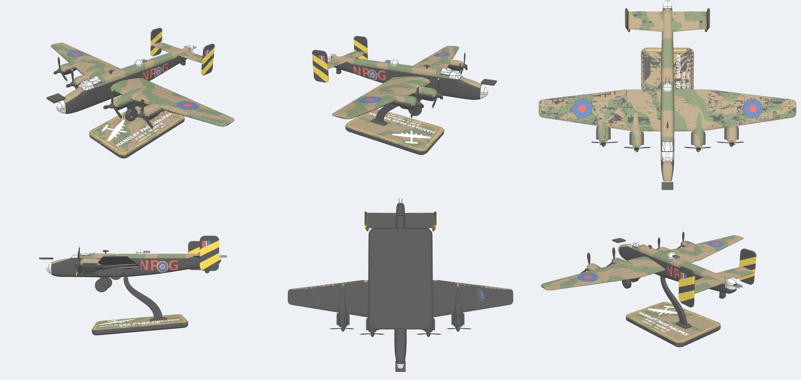
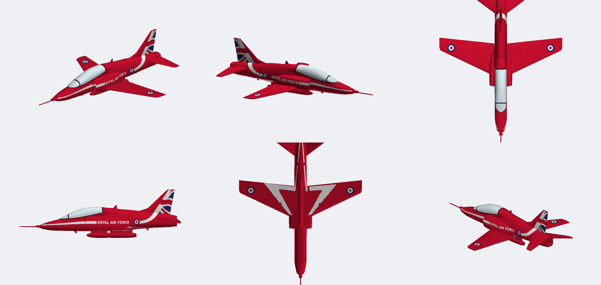

# Snap kits

Fully printed, multi-colour snap-together model aircraft kits for the Bambu Lab X2D: no glue, the markings printed into the parts, at most 5 colours a plate. Each kit has its own folder with a ready-to-print Bambu Studio file.

| Kit | Print file | |
|---|---|---|
| [Handley Page Halifax B Mk II](halifax/README.md), 1:60, 500 mm span | [`halifax/kit/halifax_kit.3mf`](halifax/kit/halifax_kit.3mf) |  |
| [BAE Hawk T.1A, Red Arrows](hawk/README.md), 1:32, 293 mm span | [`hawk/kit/hawk_kit.3mf`](hawk/kit/hawk_kit.3mf) |  |

## Layout

```
LESSONS.md        what we learned building both kits (read it before starting a new one)
requirements.txt  Python packages for the CAD scripts
common/tools/     checks and renders shared by the kits: interference, overhangs, slicing,
                  reference overlays, rasterised renders
halifax/          the Halifax: cad/ (its scripts, kit library and Bambu settings), kit/ (print
                  files), stl/, docs/, README.md, HANDOFF.md
hawk/             the Hawk: the same layout, plus tools/ (its reference calibrations)
```

Each kit keeps its own copy of the kit library (`cad/kitlib.py`) and Bambu settings for now: the two copies grew apart while both kits were being finished, and merging them means rebuilding and re-checking both kits. A new kit should start from whichever copy suits it best.

Reference images (`ref/`) and build output (`out/`) are not in the repository. Run the scripts from the repository root with the project's virtual environment, e.g. `.venv/bin/python common/tools/interference.py DIR`; each kit's README and HANDOFF.md give its build commands.

## History

Both kits were built on branches (`phase1-airframe`: the Halifax, `hawk-red-arrows`: the Hawk) and merged into `main` on 2026-11-11, when both were ready for the full print. The files moved into the folders above with `git mv`, so `git log --follow` shows each file's history.
