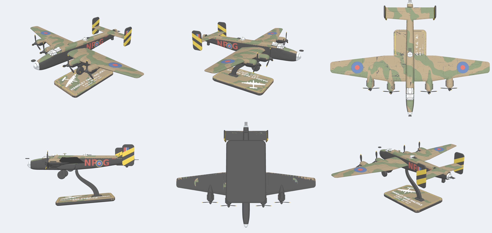

# Halifax snap kit

Handley Page Halifax B Mk II Series IA (Merlin XX), 1:60 scale, 500 mm span.
A fully printed multi-colour snap kit in the style of PB94's MasterBuilds, for the Bambu Lab X2D: no glue, no filament pins, at most 5 colours on any plate.



## Print it

Open `kit/halifax_kit.3mf` in Bambu Studio. It contains 8 plates with the filaments already assigned.

1. Print the fit test first: `stl/fit_test_plate.stl`, `fit_test_tongue.stl`, `fit_test_pins.stl` (head down) and `fit_test_key.stl`. Then adjust `AXLE_HOLE_TIGHT`, `KEY_FIT` and `FIT` in `cad/halifax.py` if needed.
2. Load the filaments for each plate. The X2D's AMS holds 4 and the auxiliary head adds a 5th.

| Plate | Parts | Filaments |
|---|---|---|
| 1 | Fuselage halves (4) | Black, Dark Earth, Dark Green, Red |
| 2 | Outer wings, tailplane | Black, Dark Earth, Dark Green |
| 3 | Inner wings | Black, Dark Earth, Dark Green |
| 4 | Nacelle halves (8) | Black, Dark Earth, Dark Green |
| 5 | Fins, roundel inlays | Black, Red, Blue, Yellow, White |
| 6 | Canopy, rear roof glazing, nose, turrets, astrodome, gun packs | Black, Clear |
| 7 | Display stand: camo plinth with badge and name, swept blade | Black, Dark Earth, Dark Green, Yellow, White |
| 8 | Props, prop shafts, exhausts, gear, wheels, pins, keys | Black, Yellow |

Suggested settings: PLA (matte for the camo), 0.16–0.2 mm layers, 2 walls, 10–15% gyroid infill, no supports.

## Kit contents (89 parts)

- **Airframe:** 4 fuselage halves, 4 wing panels, 8 nacelle halves, tailplane, 2 fins.
- **Colour inlays:** 2 Type B wing roundels and 2 C1 fuselage roundels, pressed into sockets.
- **Clear parts:** perspex nose, cockpit canopy, rear roof glazing, astrodome, dorsal and tail turrets, all with black frame lines. Plus 2 gun packs.
- **Engines:** 4 props with yellow tips, 4 prop shafts with captive flanges (the props spin), 8 exhaust banks.
- **Gear:** 2 main gear forks and wheels, tailwheel and printed axle pins. For display on the stand there are 2 wheels-up inserts that show the retracted main wheels.
- **Connector keys:** 11 between the fuselage halves, 6 at the front/rear joint, 8 in the nacelles.
- **Display stand:** a swept "swan-neck" blade that prints flat on its side, on a plinth (190 × 120 mm, bevelled underside) with a Dark Earth/Dark Green camo top, a yellow pinstripe, a raised white Halifax silhouette, and the name in raised white: HANDLEY PAGE HALIFAX / B MK II SERIES IA / 158 SQN RAF · NP-G · LV917.

**Surface detail** (sized like PB94's):
- 0.5 mm panel lines and deeper hinge lines.
- Fuel filler caps, the dinghy hatch, the crew door, roof hatches and nose windows.
- Paired rivet rows along the spars and the upper fuselage seam.
- Radiator intakes with vanes and the D/F loop fairing.

## Assembly

1. **Fuselage.** Drop the canopy and rear roof glazing over their locating bosses, press the astrodome and the nose spigot into place. Slide in the tailplane and both inner wing root tongues, port forward and starboard aft. Then close each fuselage pair on its connector keys, and join the front and rear sections on the joint keys.
2. **Wings.** Plug the outer panels onto the inner panels. The joint tongue sets the 5° dihedral. Press the roundels into their sockets.
3. **Nacelles.** Push the exhaust banks into their side slots. Drop a prop shaft into the inboard half, with its flange in the pocket. Close the outboard half around the wing on the nacelle keys, then press the prop onto the hex boss.
4. **Tail.** Fit the fins onto the tailplane tips.
5. **Turrets.** Fit the gun packs into the turrets. Pin the turrets on: the dorsal turret rotates.
6. **Display.** Either fit the gear (wheels on the headed pins, forks into their sockets) or put the model on the stand. With the gear down it sits tail-down at 8.7°. For the stand, push the blade's tenon into the plinth, fit the wheels-up inserts, and lower the model onto the key at the blade tip: it sits 5° nose-up.

## Files

- `cad/kitlib.py`: the reusable toolkit for any snap kit: colour painting, inlays, printed keys, text, the Bambu 3MF writer. Nothing in it is Halifax-specific.
- `cad/halifax.py`: parametric airframe and kit split (CadQuery).
- `cad/detail.py`: panel lines, hatches and rivets.
- `cad/colour.py`: colour scheme, roundel inlays and the Bambu 3MF writer.
- `cad/fit_test.py`: tolerance test coupon.
- `cad/render_colour.py`: colour preview renders.
- `cad/ref/camo_plan_green.png`: camo pattern traced from the Revell plan view.
- `stl/`: single-colour STLs in print orientation, with surface detail.
- `kit/halifax_kit.3mf`: the multi-colour kit.
- `docs/`: renders, the side view and the plan overlay.
- `tools/`: checks used while building:
  - `ref_overlay.py`: model outline over a reference drawing, calibrated in `tools/refs.json`.
  - `interference.py`: overlapping parts.
  - `overhang.py`: printability of the print poses.
  - `colour_check.py`: stray colours, e.g. camo on the underside.
  - `closeup.py`: close-up renders.
- `LESSONS.md`: the workflow, X2D tolerances and pitfalls. Read it before starting the next aircraft.

To rebuild (Python 3.10–3.12):

```
pip install cadquery trimesh manifold3d scikit-image matplotlib shapely lxml
python cad/colour.py out [project_settings.json]
```

## Accuracy

Geometry was measured from the Revell 1/72 Halifax B/GR II Srs IA plan views and a 51 Sqn side profile.

- Wing planform, nacelle positions and tail match the plans to about 1 mm. Wing area works out at 116.6 m² full size.
- Wing incidence is 2° at the root. The undersides are flat from 15% chord so they print without supports.
- The camo is the plan-view pattern, wrapped down to a demarcation line taken from the profile.
- Nose dome, cockpit, turret, astrodome and D/F loop come from the Revell side elevation, cross-checked against the Wikipedia Mk II Srs IA drawing (overlay in `docs/overlay_revell_side.png`).
- Markings default to 158 Sqn NP-G (LV917): scalloped demarcation and 4 Group yellow fin stripes. To use 51 Sqn MH-E instead, set `HALIFAX_MARKINGS=MH-E` before running `cad/colour.py`.
- No H2S radome: that's a Mk III / GR.II feature. Set `H2S_RADOME = True` in `cad/halifax.py` to add it.

## Reference images (not in git)

The shape and markings depend on reference drawings. They're copyrighted, so they're not committed: keep them in `ref/` (git-ignored) or a private repo. Without them `tools/ref_overlay.py` can't redraw the overlays, though everything measured from them is already in the code and `tools/refs.json`.

| File in `ref/` | Source | Used for |
|---|---|---|
| `revell_04394_p14.png` | Revell 04394 Halifax B/GR II Srs IA instructions, page 14, rendered at 400 dpi | Side and plan shape, camo pattern, glazing frames |
| `wikipedia_halifax_3view.png` | Wikipedia Halifax 3-view (Mk I to Mk III side views) | Cross-check of the side profile |
| `profile_158sqn_NP-G.jpg` | 158 Sqn LV917 NP-G colour profile | Markings (default) |
| `profile_51sqn_MH-E.jpg` | 51 Sqn MH-E colour profile | Alternative markings |

