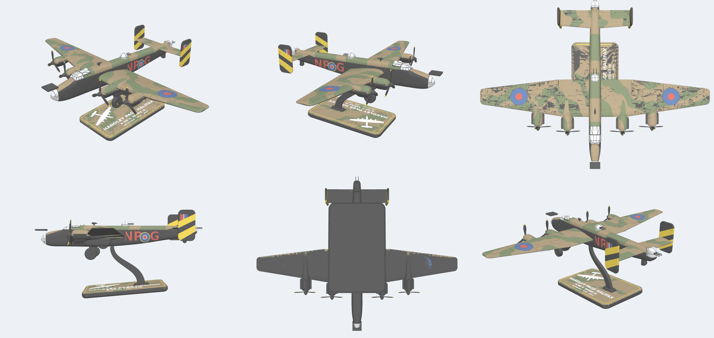

# Halifax snap kit

Handley Page Halifax B Mk II Series IA (Merlin XX), 1:60 scale, 500 mm span.
A fully printed multi-colour snap kit in the style of PB94's MasterBuilds, for the Bambu Lab X2D: no glue, no filament pins, at most 5 colours on any plate.



## Print it

Open `kit/halifax_kit.3mf` in Bambu Studio. Every part is placed for printing, with the filaments assigned.

The wings print standing on end, like the fuselage. Layer lines then run along the span and barely show, and the leading edges come out smooth. Printed flat, the leading-edge undersides are rough overhangs. The cost is more colour changes and purge on the wing plate. The flat layout can still be generated with `HALIFAX_WING_POSE=flat`, for reference.

1. Print the fit test first (`stl/fit_test_*`), then adjust `AXLE_HOLE_TIGHT`, `KEY_FIT` and `FIT` in `cad/halifax.py` if needed. The X2D values are already set.
2. Load the filaments for each plate. The X2D's AMS holds 4 and the auxiliary head adds a 5th.

| Plate | Parts | Filaments |
|---|---|---|
| Fuselage | Front and rear body sections, standing on end (use a brim) | Black |
| Spine | 6 camo spine pieces on end (cut and oriented for fewest purges), painted from the plan pattern, and the D/F loop (Dark Earth) | Dark Earth, Dark Green |
| Wings | Inner and outer panels, tailplane | Black, Dark Earth, Dark Green |
| Nacelles | 8 nacelle halves | Black, Dark Earth, Dark Green |
| Fin flashes, roundels and codes | Roundel inlays, NP-G code letters | Black, Red, Blue, Yellow, White |
| Canopies and turrets | Cockpit canopy (2 pieces) and rear roof glazing with camo frames, nose, turrets, astrodome | Black, Silk Silver, Dark Earth, Dark Green |
| Display plinth | Camo plinth (150 × 95 mm, no black) with raised white badge and name | Dark Earth, Dark Green, Yellow, White |
| Props, gear, fins, guns and stand blade | Fins, props, exhausts, 2-piece gear forks, wheels, gun packs, keys, stand blade | Black, Yellow |

Print settings are already in the files, set up for the X2D 0.4 mm nozzle:

- **Layers:** 0.16 mm, or 0.12 mm on the canopy plate and the props, gear and keys plate.
- **Infill and supports:** gyroid 15% infill, no supports.
- **Brim:** a 6 mm brim on everything that stands on end. The fuselage sections also get 3 walls.

Filament presets are left as PLA Basic. In Bambu Studio, pick your own preset for each slot (matte for the camo, silk for the canopies) so the temperatures match. The canopy and turret slot is set to **silk silver** for a display finish. Swap it for clear PETG if you want see-through glazing, and print the black frames in PETG on that plate too.

The single-colour STLs are in `stl/`, in print orientation.

## Kit contents (102 parts)

- **Fuselage (Lancaster-style):**
  - 2 full-width black body sections, printed on end so there's no seam along the spine.
  - 6 camo spine pieces on the scalloped demarcation line, painted from the plan pattern so the camo runs on into the wings, cut and stood on end for the fewest colour changes.
- **Airframe:** 4 wing panels, 8 nacelle halves, tailplane, 2 fins.
- **Colour inlays:**
  - Type B wing roundels and C1 fuselage roundels.
  - The NP-G code letters in red.
  - All press into black-lined sockets.
- **Clear parts:** perspex nose, cockpit canopy in two pieces (the 5-pane front glazing, and the side windows, which step down below the camo line), rear roof glazing, astrodome, dorsal and tail turrets, all with black frame lines. Plus 2 gun packs.
- **Engines:** 4 props with yellow tips that snap onto a slotted, sprung mushroom boss moulded on each nacelle nose and spin on it (after the A6M Zero kit card: no shaft or spindle), 8 exhaust banks.
- **Gear:** 2 main gear forks and wheels and a tailwheel. Each fork is two halves: one has a printed stub axle (5 mm main, 3 mm tail) that runs through the wheel into the other half, so there are no loose pins. For display on the stand there are 2 wheels-up inserts that show the retracted main wheels.
- **Connector keys** (6 loose, all flexing, after the PB94 Spitfire: spring slots at the ends and a narrow middle, so they push in easily and grip):
  - 2 tall keys at the front/rear joint.
  - 2 at the inner/outer wing joints.
  - 4 nacelle locks (2 sizes): each joins the nacelle halves and pins the nacelle into a pocket in the wing underside.
  - The spine pieces locate on pegs printed on the black body, and the fins on tabs printed on the tailplane tips: no loose keys there.
- **D/F loop:** a separate camo-painted part that pops into a socket in the roof.
- **Display stand:**
  - A swept "swan-neck" blade that prints flat on its side.
  - A plinth (150 × 95 mm, bevelled underside) with a Dark Earth/Dark Green camo top and a yellow pinstripe.
  - A raised white Halifax silhouette, and the name in raised white: HANDLEY PAGE HALIFAX / B MK II SERIES IA / 158 SQN RAF · NP-G · LV917.

**Surface detail** (sized like PB94's):
- 0.5 mm panel lines and deeper hinge lines.
- Fuel filler caps, the dinghy hatch, the crew door, roof hatches and nose windows.
- Paired rivet rows along the spars and the lower fuselage seam.
- Radiator intakes with vanes.

## Assembly

1. **Fuselage.**
   - Join the front and rear body sections on the 2 tall joint keys.
   - Drop the canopy and rear roof glazing over their locating bosses, and press in the astrodome and the nose spigot. The canopy is two pieces: the side-window piece first (boss on the body), then the front glazing (boss on the nose spine piece).
   - Slide both inner wing root tongues into their side pockets, port forward and starboard aft.
   - Lay the tailplane on its seat.
   - Press the spine pieces on, nose to tail, over the pegs on the body. The piece over the tail holds the tailplane down, and the piece over the joint locks the two sections together.
   - Push the D/F loop into its socket in the roof.
   - Press in the red code letters and the roundels: each letter has a hole in its back that grips a peg on the socket floor. Each roundel (wing and fuselage) has an off-centre peg, so it only fits one way round and grips, and an L or R engraved on its back.
2. **Wings.** Join each outer panel to its inner panel with a wing key. The joint faces set the 5° dihedral. Press the wing roundels into their sockets.
3. **Nacelles.**
   - Push the exhaust banks into their side slots.
   - Push the nacelle lock key up into its pocket in the wing underside (the longer key is for the inner nacelles).
   - Close both halves around the wing and the key.
   - Push the prop onto the nose boss last: the slotted boss squeezes, then springs out behind the prop's lip, and the prop spins.
4. **Tail.** Push the centre key into one tailplane half, slide the two halves into the fuselage slot from each side and press them together on the key. Then slide each fin's dovetail rod into the slot under its tailplane tip until the teeth click. (The fin flashes are printed on the fins.)
5. **Turrets.** Fit the gun packs into the turrets. Pin the turrets on: the dorsal turret rotates.
6. **Display.** Either fit the gear (wheel onto the stub on one fork half, close the other half over it, then push the pair into its socket) or put the model on the stand. With the gear down it sits tail-down at 8.7°. For the stand, push the blade's tenon into the plinth, fit the wheels-up inserts, and lower the model onto the key at the blade tip: it sits 5° nose-up.

## Files

- `cad/kitlib.py`: the reusable toolkit for any snap kit: colour painting, inlays, printed keys, text, the Bambu 3MF writer. Nothing in it is Halifax-specific.
- `cad/halifax.py`: parametric airframe and kit split (CadQuery).
- `cad/detail.py`: panel lines, hatches and rivets.
- `cad/colour.py`: colour scheme, roundel inlays and the Bambu 3MF writer.
- `cad/fit_test.py`: tolerance test coupon.
- `cad/render_colour.py`: colour preview renders.
- `cad/ref/camo_plan_green.png`: camo pattern traced from the Revell plan view.
- `stl/`: single-colour STLs in print orientation, with surface detail.
- `kit/halifax_kit.3mf`: the multi-colour kit.
- `docs/`: renders, the side view and the plan overlay.
- `tools/`: checks used while building:
  - `ref_overlay.py`: model outline over a reference drawing, calibrated in `tools/refs.json`.
  - `interference.py`: overlapping parts.
  - `overhang.py`: printability of the print poses.
  - `colour_check.py`: stray colours, e.g. camo on the underside.
  - `closeup.py`: close-up renders.
- `LESSONS.md`: the workflow, X2D tolerances and pitfalls. Read it before starting the next aircraft.

To rebuild (Python 3.10–3.12):

```
pip install cadquery trimesh manifold3d scikit-image matplotlib shapely lxml
python halifax/cad/colour.py out [project_settings.json]
```

## Accuracy

Geometry was measured from the Revell 1/72 Halifax B/GR II Srs IA plan views and a 51 Sqn side profile.

- Wing planform, nacelle positions and tail match the plans to about 1 mm. Wing area works out at 116.6 m² full size.
- Wing incidence is 2° at the root. The undersides are flat from 15% chord so they print without supports.
- The camo on the wings, tailplane and nacelles is the Revell plan-view pattern. For NP-G, the fuselage band is traced from the aircraft's own profile and carried over the roof, above a scalloped demarcation line.
- Nose dome, cockpit, turret, astrodome and D/F loop come from the Revell side elevation, cross-checked against the Wikipedia Mk II Srs IA drawing (overlay in `docs/overlay_revell_side.png`).
- Markings default to 158 Sqn NP-G (LV917): scalloped demarcation and 4 Group yellow fin stripes. To use 51 Sqn MH-E instead, set `HALIFAX_MARKINGS=MH-E` before running `cad/colour.py`.
- No H2S radome: that's a Mk III / GR.II feature. Set `H2S_RADOME = True` in `cad/halifax.py` to add it.

## Reference images (not in git)

The shape and markings depend on reference drawings. They're copyrighted, so they're not committed: keep them in `ref/` (git-ignored) or a private repo. Without them `common/tools/ref_overlay.py` can't redraw the overlays, though everything measured from them is already in the code and `tools/refs.json`.

| File in `ref/` | Source | Used for |
|---|---|---|
| `revell_04394_p14.png` | Revell 04394 Halifax B/GR II Srs IA instructions, page 14, rendered at 400 dpi | Side and plan shape, camo pattern, glazing frames |
| `wikipedia_halifax_3view.png` | Wikipedia Halifax 3-view (Mk I to Mk III side views) | Cross-check of the side profile |
| `profile_158sqn_NP-G.jpg` | 158 Sqn LV917 NP-G colour profile | Markings (default) |
| `profile_51sqn_MH-E.jpg` | 51 Sqn MH-E colour profile | Alternative markings |

