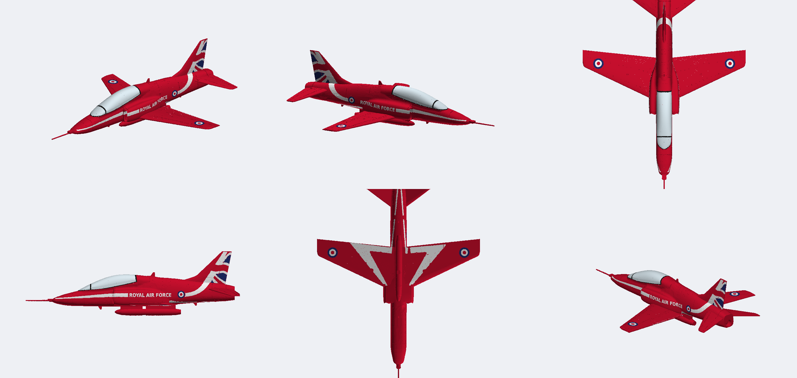
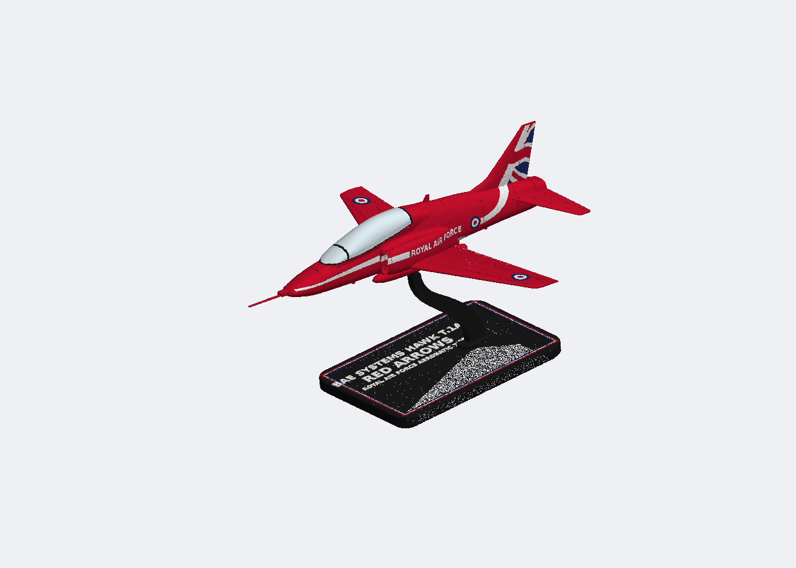
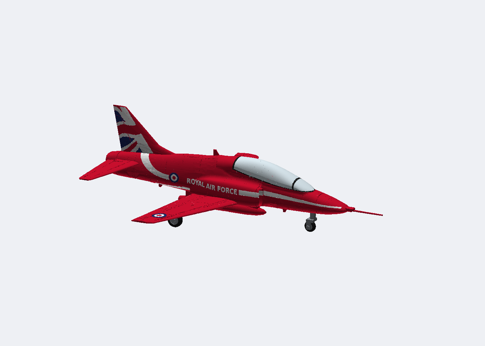
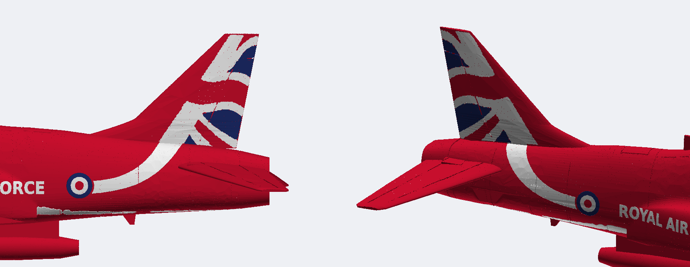
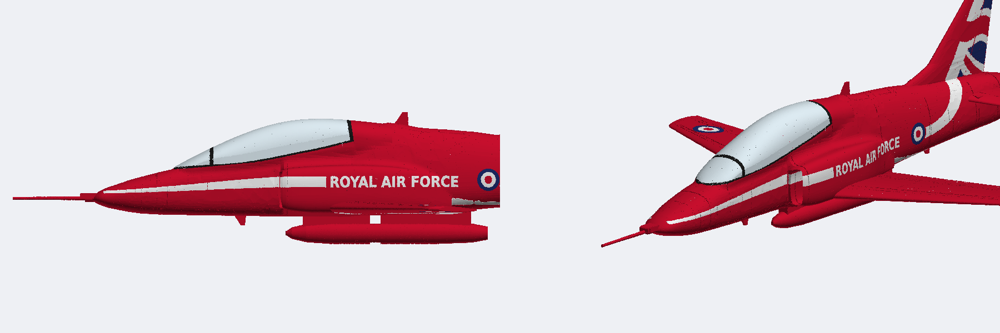
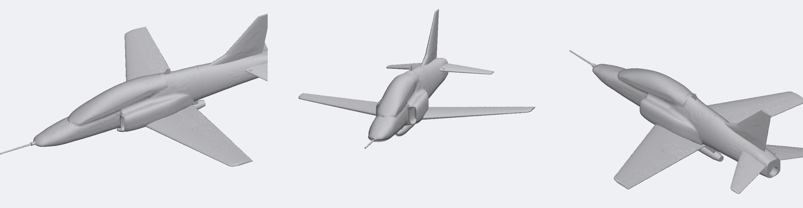
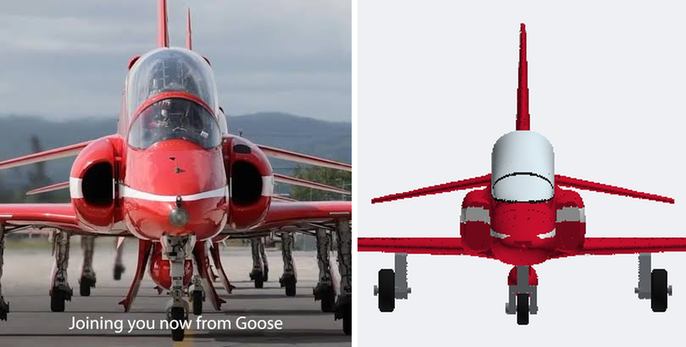
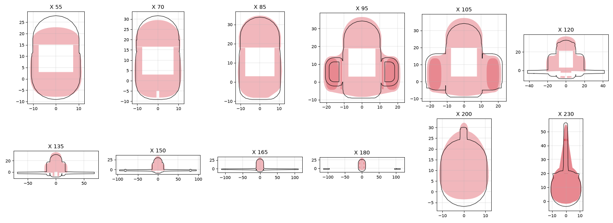
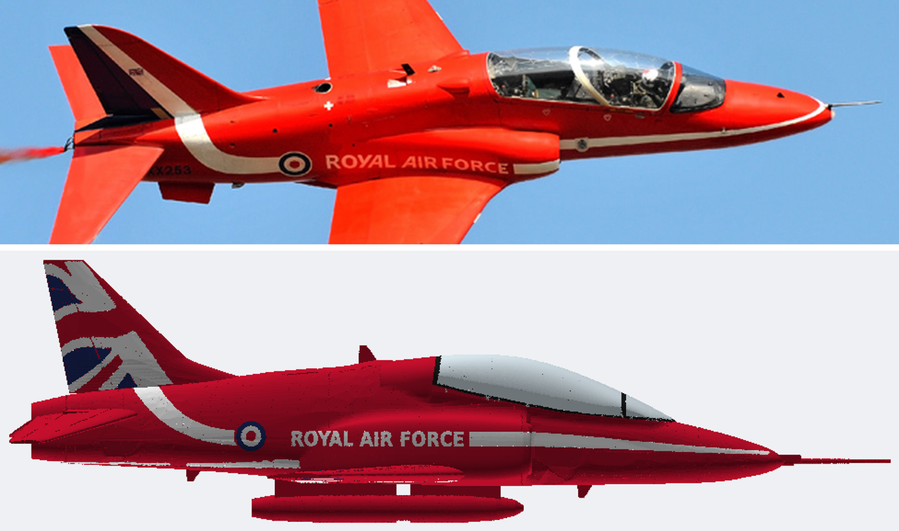

# Hawk snap kit

BAE Systems Hawk T.1A of the Red Arrows, 1:40 scale: 235 mm span, 299 mm long with the probe.
Fully printed multi-colour snap kit for the Bambu Lab X2D, built the Halifax v2 way: red fuselage sections printed on end with no centre seam, and the white markings as press-in inlays.



| On the stand | Gear down |
|---|---|
|  |  |





Shape without paint, and head-on against a photo:





Cross-sections against a reference 3MF (ours filled, reference outlined):



Against photos (top: real aircraft, bottom: model):



> **Status: v1, not yet test-printed.** The geometry passes the three checks in `LESSONS.md` (single pieces, interference, overhangs). The fits use the Halifax fit-test numbers. Print the fuselage joint, one wing root and a few letter inlays first.

## Print it

Open `kit/hawk_kit.3mf` in Bambu Studio. Its 6 plates have the filaments already assigned.

| Plate | Parts | Filaments |
|---|---|---|
| Fuselage and red parts | Front and rear fuselage on end (brim), radome on its back face (probe up), tailplanes, smoke pod halves, aerials, keys | Red |
| Wings | Both wings flat; white underside chevrons in the first layers | Red, White |
| Fins, roundels and white inlays | Fin halves (Union flag in the skin), roundels, cheat-line, belly-stripe and letter inlays | Red, White, Blue |
| Canopy and cockpit | Solid canopy (print at 100% infill for clarity), tandem cockpit tub | Clear, Black, Red, Grey |
| Display stand | Plinth with red/white/blue pinstripe and raised lettering, swept blade | Black, Red, White, Blue |
| Gear | Nose and main legs, wheels, axle pins | Grey, Black |

Suggested settings: PLA, 0.16 mm layers for the inlay and gear plates and 0.2 mm elsewhere, 2 walls, 15% gyroid infill, no supports. Use a brim on the front fuselage section, which stands 159 mm tall.

## Kit contents (92 parts)

- **Airframe:**
  - radome with pitot probe
  - front and rear fuselage sections
  - 2 fin halves, which carry the spine cap and the dorsal fillet
  - 2 wings
  - 2 tailplanes with 10° anhedral
  - smoke pod (2 halves)
  - 3 aerials
- **Cockpit:**
  - solid clear canopy with a black windscreen arch, an upright rear frame and a curved sill frame
  - tandem tub with the raised rear seat, side consoles, 2 seats (headboxes, firing handles, grey cushions), 2 instrument panels with coamings, and control columns
- **White inlays:**
  - cheat line, 4 pieces per side: thin at the nose, thickening to the lettering's height on the side pod, stopping at the lettering
  - tail swoosh, 2 pieces per side: from behind the roundel, sweeping up to the fin flag
  - 9 belly-stripe pieces
  - 26 letters ("ROYAL AIR FORCE" on each side)
- **Roundels:**
  - 2 on the fuselage
  - 2 wing roundels that pass right through the wing, so one disc shows above and below
- **Gear:** nose leg, 2 main legs, 3 wheels with grey hubs, headed axle pins.
- **Keys:**
  - 5 at the fuselage joint
  - 1 radome key
  - 3 joining the fin halves (1 full key in the spine cap, 2 short ones lower in the fin)
  - 3 joining the pod halves
  - 2 pod-to-belly
- **Stand:** a swept blade on a 170 × 110 mm plinth. The model sits 6° nose-up on a key that passes through the smoke pod.

**Surface detail:**
- 0.5 mm panel lines, with deeper hinge lines on the flaps, ailerons and rudder (top and bottom).
- Access panels and a fuel filler cap.
- Rivet rows on the spars.
- Intake ducts with a boundary-layer splitter gap.
- A recessed jet pipe with its cone.

## Assembly

1. **Cockpit and canopy.** Drop the cockpit tub into the front section. The canopy then sits on it: the seat headboxes and coamings nest into pockets under the canopy, which locates it.
2. **Fuselage.**
   - Join the front and rear sections on the 5 joint keys.
   - Key the radome on.
   - Press in the white inlays and the roundels. Letters are numbered in reading order on each side: `inlay_letter_port_01` and `inlay_letter_stbd_01` are both the R.
3. **Fin.** Join the halves on their 3 keys: the full key goes in the spine cap, the 2 short ones in the fin. Then push the fin's root tongue into the slot in the spine.
4. **Wings and tailplanes.** Slide the root tongues into the side pockets. On both the wings and the tailplanes, the port tongue goes forward and the starboard tongue aft. Press the wing roundels into their through-holes.
5. **Smoke pod.** Join the halves on 3 keys and push them onto the 2 belly keys.
6. **Display.** Either fit the gear (wheels on the headed pins, legs into their sockets) or use the stand: push the blade's tenon into the plinth and lower the model onto the key.

## Accuracy

The shape is measured from the Revell 04284 Hawk T.1A (Red Arrows) instruction sheet, pages 15 and 16, rendered at 400 dpi. The calibration is in `tools/refs.json`, and the overlays are `docs/overlay_revell_*.png`.

- Scaled by the real span of 9.39 m. As cross-checks, the wing area comes out at 16.8 m² (real 16.69), the root chord at 2.66 m (real 2.65), and the length including the probe at 11.96 m.
- The side views on the sheet are drawn about 12% larger than the plan views, so each view has its own calibration.
- The plan view's wings sit about 20 px off the fuselage centreline, and its two halves differ by 5%. The model uses the average of the two halves.
- The undersides are flat from 15% chord, so the wings and tailplanes print without supports.
- Behind the cockpit the fuselage uses an "egg" cross-section. It's widest at the side pods and rounder on top, following the spine line, so the top is smooth with no separate spine ridge.
- The fin's leading edge sweeps forward below 36 mm into a thin dorsal fillet that rises out of the spine at about X 192, as on the real aircraft.
- The windscreen front is a rounded U in plan (Revell top view), so the glazing rises out of the nose instead of starting as a flat, full-width sliver.
- The canopy's lower edge follows the HobbyBoss side view: nearly level under the front cockpit, curving up under the rear seat to an almost upright rear frame at X 122–125. The part is still cut on a flat plane so it prints flat. Below the curved edge it's painted red, with a black sill frame along the edge.
- The canopy top line is one continuous convex curve: a smoothing spline through the measured points, lofted densely so there is no wobble. It ends with a slanted rear frame around X 128–134. It sits on a sill plane that follows the cockpit deck. Under it, the seats are placed where the pilots actually sit (seat backs at X 76 and X 112), with at least 1.2 mm of clear canopy over each headbox.
- Fuselage widths follow the fuselage edge in the Revell plan view: about 11.4 mm half-width at the cockpit and 11.6 behind it, tapering from X 208. (An earlier version traced the wing-root and pod outline there instead and came out 3 mm too wide a side, which made the area around the wing root look lumpy.) The cockpit section is squarer (exponent 3.0), so the sides run up nearly vertical to the canopy.
- The fuselage, canopy and side pods are blended as one skin from X 34 to 192. Each cross-section has its concave creases closed with a 4.5 mm radius and is filled to its hull below Z 2 (pod undersides flush with the belly, lower outer corners rounded at 6.5 mm). Ahead of the intake lip the pods are left out of the blend, so nothing plugs the intakes.
- The side pods are boxy D-sections (exponent 3.0): 21.7 mm half-width, a flat top just above the lettering (Z 14–16, from the Revell side view), a near-vertical outer side and a flat bottom. They fade into the body between X 147 and 170. Rounded intake lips.
- The canopy section is an egg shape, checked against the head-on photo: its sides rise from the fuselage, curve very slightly out just above the sill (widest 2.5 mm above it, 3% wider than the spine table) and round over the top.
- **Cross-check against another model.** The fuselage and pod sections were compared with a 1:72 Hawk 3MF by Greenwater (`tools/compare_ref_model.py`, result in `docs/ref_model_sections.png`). Widths and pod shape now agree. Where they disagree, the model follows the Revell drawings: the reference's canopy and spine are 3–5 mm lower and its windscreen starts further forward, and its fuselage is a constant-width tube.
- The side pods fade into the fuselage by the wing trailing edge (X 168). The end of "ROYAL AIR FORCE" sits on the fuselage side just behind them.
- The rear top line stays nearly level from the fin to the jet pipe (Revell side view), and the end is squared off, as in the photos.
- The side pods (intake trunks) are rounded, with 18 mm deep ducts that read dark, as in the head-on photo. Their tops reach Z 15.
- **Gear (positions from photos):**
  - The nose leg is at X 40.
  - The main legs plug in at X 150, where the wing is 4.1 mm thick, and rake aft so the wheels sit at X 168, near the trailing edge. The track is 3.47 m.
- **Fuselage depth below the nose line:** the sources disagree. Revell and the side-on photo give about 8 mm under the cockpit; HobbyBoss gives 14 mm. The model follows Revell and the photo.
- The fin is 10% thick (the real one is about 8.5%), so the key slots between its halves keep their wall.

## Markings

The scheme is the current one, with the Union-flag fin. It combines two sheets:

- **Fin flag:** traced from the HobbyBoss 81738 side views with `tools/trace_colours.py`, one trace per side (specs in `tools/fin_flag_*.json`). Each view is fitted to the model through its fin corners and the nose tip, so the flag lands exactly on our fin. It's clipped to the fin itself: above the fuselage top line and behind the straight leading edge, so the spine cap and dorsal fillet stay red.
- **Cheat line and swoosh** (parametric, from the photos, the same on both sides):
  - From the nose the line starts 1.3 mm wide and thickens gradually to the letter height (5.2 mm) on the side pod, then stops 2 mm short of "ROYAL AIR FORCE".
  - It resumes behind the roundel at the same height and sweeps up in one curve (a cubic Bezier) to the fin root, widening to 8 mm, where it meets the flag's white.
- **Lettering and roundels:** follow the Revell sheet and the photos.
  - The lettering is regenerated as text, so it reads correctly on both sides.
  - The roundels are Type D (red, white and blue in thirds).
- **Underside chevrons and belly stripes:** traced from the Revell underside view (`tools/white_regions.py`).
- **Where the traces live:** in `ref/hawk_white/`, which is git-ignored. Re-run the trace commands below to regenerate them.

## Rebuild

From the repo root, with `requirements.txt` installed:

```
.venv/bin/python tools/white_regions.py under ref/hawk_white/under.json --refs hawk/tools/refs.json
for s in port stbd; do
  .venv/bin/python tools/trace_colours.py hawk/tools/fin_flag_$s.json   ref/hawk_white/fin_$s.json
done
cd hawk/cad
../../.venv/bin/python hawk.py ../../out/hawk/geo        # geometry only, about 10 s
../../.venv/bin/python colour.py ../../out/hawk/col      # colour, inlays, 3MF, about 2 min
ONLY=wing_stbd ../../.venv/bin/python colour.py ../../out/hawk/col   # one part
cd ../..
.venv/bin/python tools/render.py out/hawk/col/hawk_colour_preview.glb hawk/docs/colour_render.png --skip gear_,wheel_,pin_,stand --zoom 1.5
```

Checks: run `tools/interference.py` on the assembled STLs without the `key_*` files (keys are modelled at the origin), and `tools/overhang.py` on `out/hawk/geo/print`.

## Files

- `cad/hawk.py`: station tables, parts, joints, print poses. CadQuery only makes the lofts and primitives; every boolean runs in manifold3d.
- `cad/colour.py`: the Red Arrows scheme, the inlays, and the plates and 3MF.
- `cad/detail.py`: panel lines, hinge lines, access panels and rivets.
- `tools/refs.json`: calibration of the Revell views. `tools/fin_flag_*.json` holds the HobbyBoss trace specs. `tools/measure.py` is the diagnostic profile dump.
- `stl/`, `kit/`, `docs/`: outputs, as for the Halifax.

## Reference images (not in git)

| File in `ref/` | Source | Used for |
|---|---|---|
| `CM_04284.pdf` | Revell 04284 BAe Hawk T.1A Red Arrows instructions | Shape (pages 15–16), white areas |
| `revell_04284_p15.png`, `revell_04284_p16.png` | Those pages rendered at 400 dpi | Calibrated views |
| `hawk/hobbyboss_81738_sheet2.webp` | HobbyBoss 81738 marking sheet II (current scheme) | Union-flag fin, both sides |
| `hawk/hobbyboss_81738_sheets1_2.webp` | HobbyBoss 81738 sheets I and II, small | The older blue-fin scheme, for a future variant |
| `hawk/photo_*.png/.webp` | Red Arrows photos: side-on taxiing (starboard), head-on, port flight, fin close-ups both sides, high 3/4 | Canopy line, intakes, gear positions, cheat line, fin flag |
| `hawk/render_50th_scheme_port.png`, `hawk/photo_port_ground_2010_bluefin.png` | Other schemes | Future variants |
| `hawk/grwtr_3mf/grwtr-BAEHawkT1_72.3mf` | Greenwater's 1:72 BAE Hawk T1 (Standard Digital File License) | Cross-section check of fuselage, pods and canopy only; no geometry copied |

## Known gaps and next steps

- Add the older blue-fin scheme (HobbyBoss sheet I, Revell 2010) as an option.
- Add the ventral strakes, the airbrake outline, the canopy detonating-cord (MDC) lines and the intake auxiliary doors.
- Add gear doors for the gear-down display.
- Print a fit coupon for the letter inlays and the nose end of the cheat line: both are about 1–1.3 mm wide, at the printable limit.
