# Hawk snap kit

BAE Systems Hawk T.1A of the Red Arrows, 1:32 scale: 293 mm span, 374 mm long with the probe.
Fully printed multi-colour snap kit for the Bambu Lab X2D, built the Halifax v2 way: red fuselage sections printed on end with no centre seam. All the markings are painted into the parts (multi-colour printing), so there is nothing to press in.

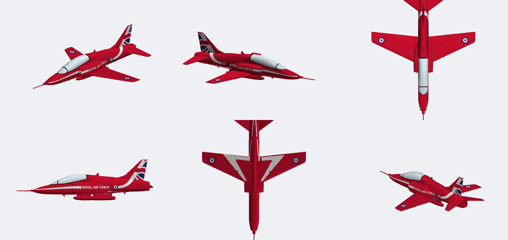

| On the stand | Gear down |
|---|---|
| 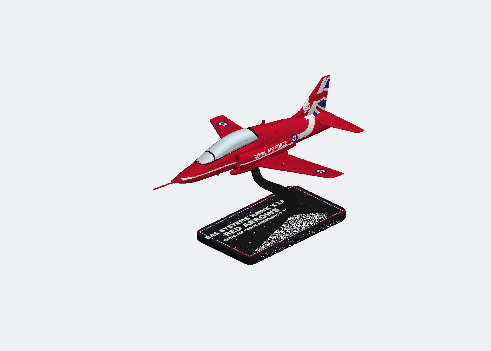 | 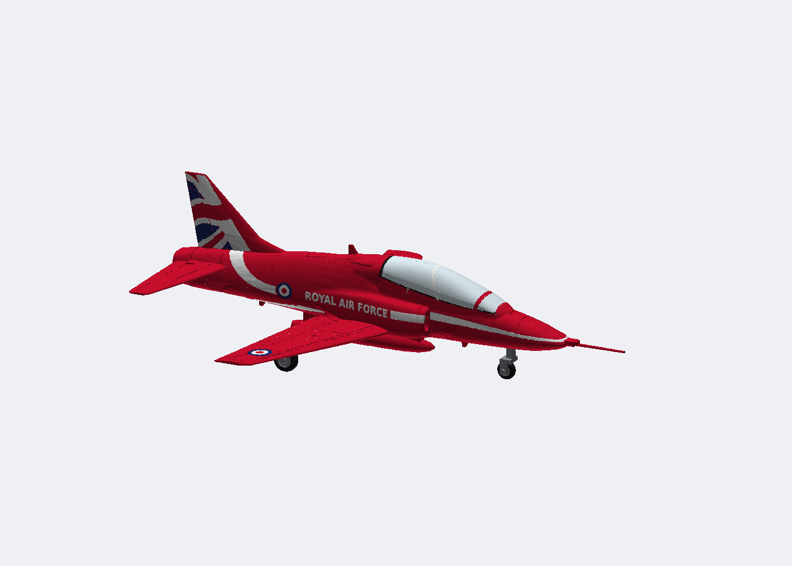 |

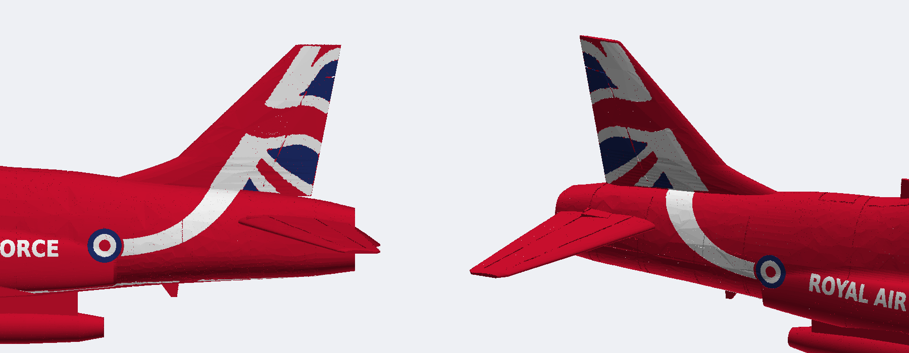

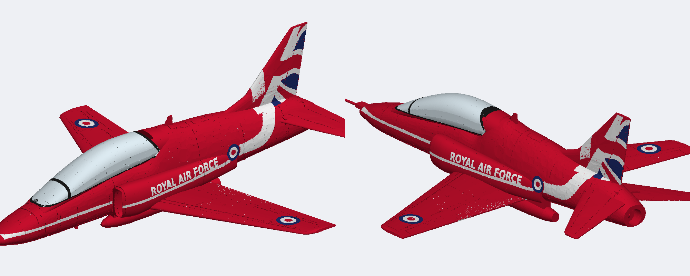

Painted markings, the opaque canopy and the underside chevrons:

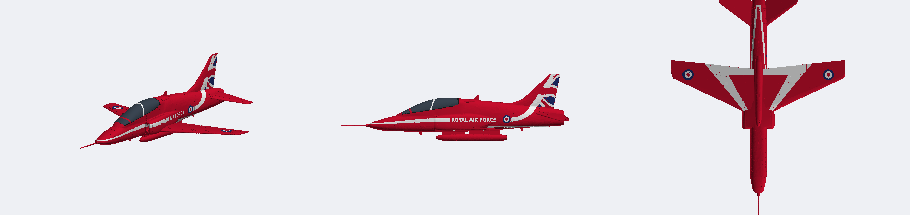

The red nose dome under the windscreen, with the canopy on and off (the nose keeps only the front of the dome; the canopy's front is a vertical face against it):

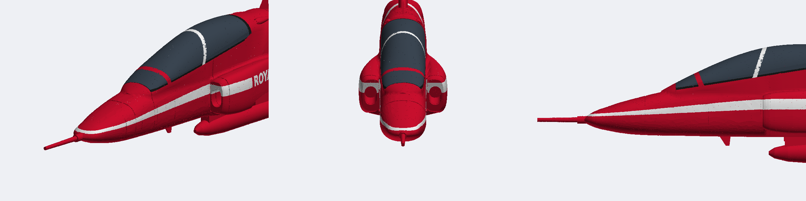

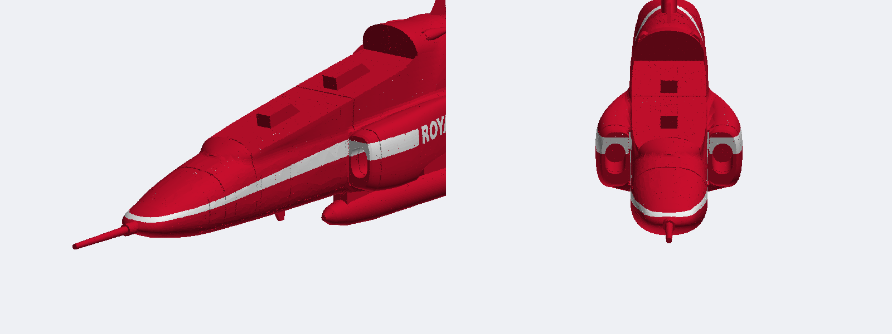

The tailplane roots (each panel's own section plugs into a matching socket; no tongue):

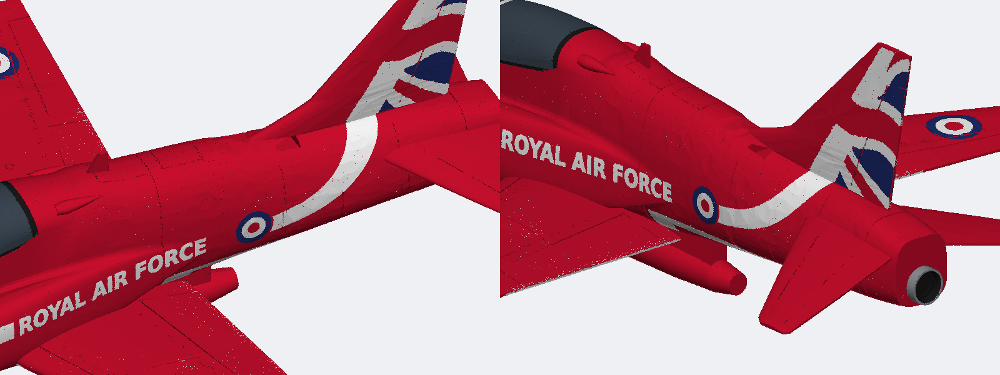

The jet nozzle, a separate part:

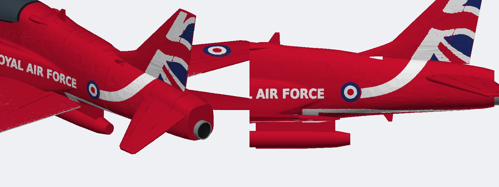

The 150 × 100 mm plinth:

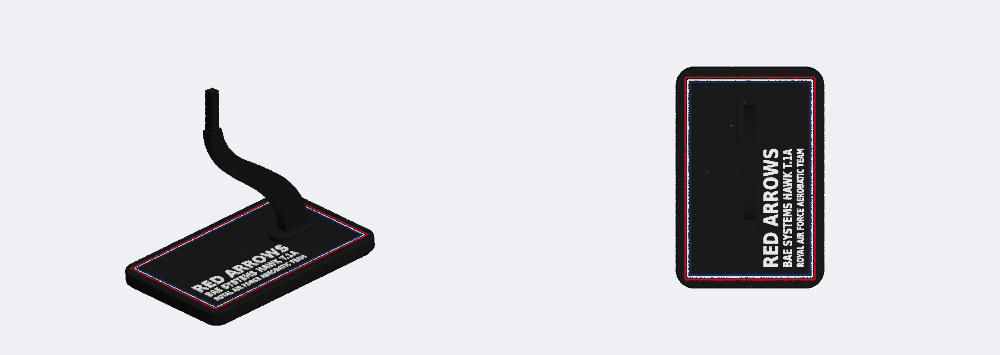

Shape without paint, and head-on against a photo:

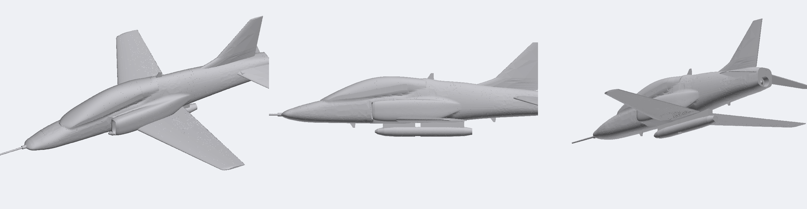

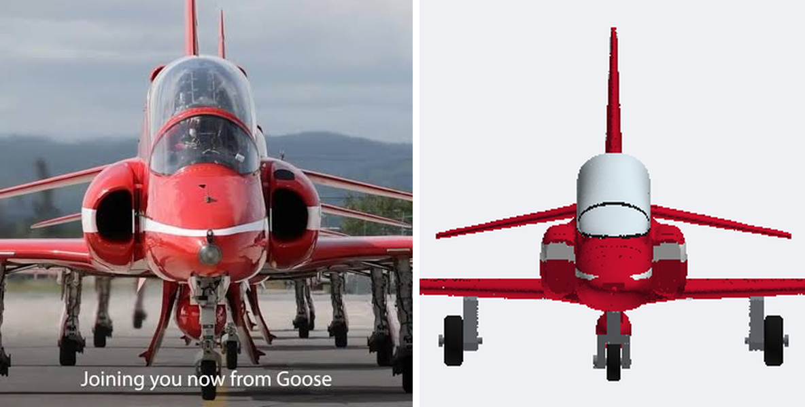

Cross-sections against a reference 3MF (ours filled, reference outlined):

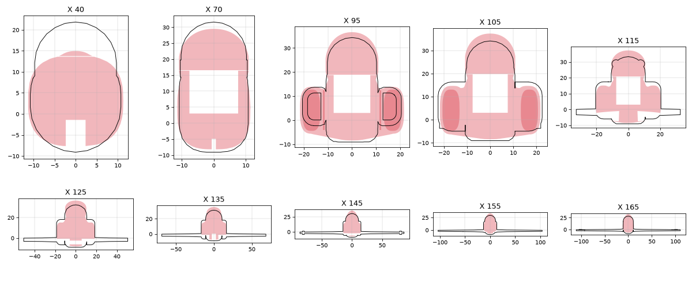

Against photos (top: real aircraft, bottom: model):

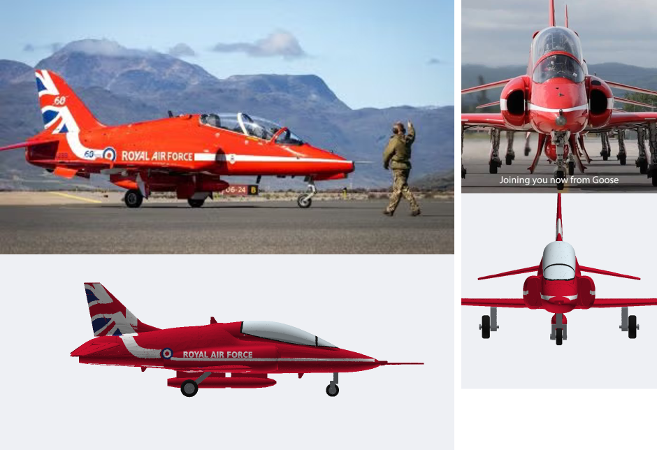

> **Status: v6, not yet printed.** v4 fixed what the first test print showed (see "Test print 1" below); v5 reworks the shape and markings against photos (see "v5 changes"). The geometry passes the three checks in `LESSONS.md` (single pieces, interference, overhangs).

### v6 changes (from the v5 renders)

- **Smoke pod tail:** the top stays on the line and the underside sweeps up, so the pod tapers into the belly instead of ending in a free cone.
- **Wings:** raised 1 mm, so the root underside sits about 2 mm (printed) above the fuselage's lowest point and some fuselage shows below the wing.
- **Under-wing fins:** three small fences behind the leading edge and two flap-track fairings at the trailing edge, on each wing.
- **Wheel bays:** a shallow recess in each wing underside for the retracted main wheel, with a channel out to the leg socket.
- **Side pods:** a longer, lower fade into the fuselage side and down onto the wing's rear root (to X 190, with a larger blend radius), so there is no visible end.
- **Belly stripes:** widest where they leave the wing trailing-edge white (one continuous band), narrowing to the tail.
- **Rear fuselage:** near-square top corners as well as bottom ones.

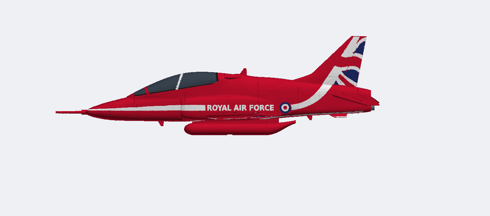

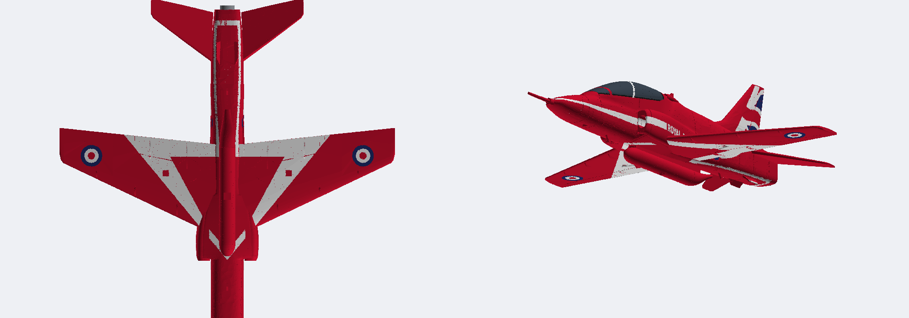

### v5 changes (from photos)

- **Markings:** "ROYAL AIR FORCE" moved down to half way up the side pod, so the cheat line from the nose runs nearly level instead of climbing. The roundel is level with the lettering and just behind the last letter (X 185, was 187).
- **Wings in two halves:** the underside now has a true cambered aerofoil, not a flat bottom. Each wing splits on its chord plane into a top and a bottom half; each half prints flat on the split face with its outer skin up, so the roundels and chevrons print sharp in the top layers on both sides. Five pins line the halves up; glue them. The trailing edge is 1.5 mm thick (printed) so each half keeps 0.75 mm there.
- **Smoke pod:** a fatter tube (14 mm printed) with a round blunt nose and a long tail cone, hung close under the belly.
- **Ventral strakes:** two small canted blades under the rear fuselage.
- **Rear fuselage:** nearly square-cornered underneath towards the tail; the belly stripes run along those corners, so from the side they show as a thin white line.
- **Belly:** the wing chevrons now meet across the belly in a V at the smoke pod's nose.
- **All-moving tailplanes:** each turns on a round spigot in a teardrop hole (snug, so it holds its setting), with about 12° of travel each way clear of the fuselage.
- **Aerials:** press fit line-for-line in thickness (two of the three fell out of the v4 slots).
- **Spine scoops:** bigger (6 × 3.25 mm printed) so they read at this scale.


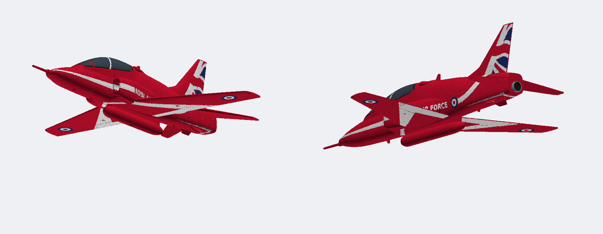

### Test print 1 (fuselage plate, v3)

| Problem | v4 fix |
|---|---|
| Rough fuselage where it wraps the wing leading edge: the section prints on end, nose up, and over the round leading edge its socket was a flat ceiling | A filler moulded on each wing root, ahead of the leading edge and inside the intake pod, with a 45° roof: the pod now prints over a pointed arch. Only a seam shows |
| Overhang where the canopy front meets the fuselage (the dome's vertical face, part way up the nose section) | A fourth fuselage piece: the fuselage is also cut at X 46, on the dome face, so that face prints on the bed |
| Pitot probe likely to break | The probe is its own part, pushed into a hole in the nose tip: a broken one is a 10-minute reprint |
| Stand key went right through the smoke pod and into the belly | The socket is blind, in the pod only; nothing shows through. The pod's pegs carry the model |
| Tailplane tabs overhung | Already gone in v3 (root-section sockets) |
| Wings, as sliced: underside white showing on the top surface near the trailing edge and as squares over the gear sockets | The white is 2 layers thin, never within 2 layers of the top, and measured with the sockets filled in, so socket ceilings get none |
| Wings did not slide into the fuselage (seen on the older tongue version) | v3 already replaced the tongues: the wing root sits flush on the fuselage side and pushes straight in on one big key. Not yet test-printed |

In v4 the fuselage plate sliced at about 15 hours (the slicer's reheat waits for the idle nozzle grew with less to print per layer). In v5 it is about 11 hours, mainly because the lower lettering shares its layers with the cheat line. Separate lettering panels (see "Known gaps") would remove most of the nozzle swaps.

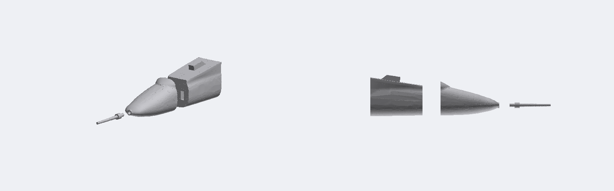

The stand now plugs into a blind socket in the smoke pod:

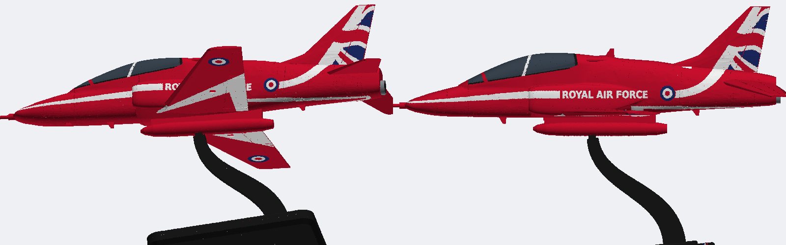

## Print it

Open `kit/hawk_kit.3mf` in Bambu Studio. Its 7 plates have the filaments already assigned. Slot 5 is the canopy colour: the canopy is opaque, so load any colour you like for it (smoke grey or dark blue look right).

| Plate | Parts | Filaments |
|---|---|---|
| Fuselage | Nose, front, middle and rear fuselage sections on end (brim), smoke pod halves. The cheat line, swoosh, "ROYAL AIR FORCE", roundels and belly stripes are painted in | Red, White, Blue |
| Tailplanes and small parts | Tailplanes, aerials, probe (standing on its plug: use a brim), wing pins, all keys | Red |
| Wing tops | Top halves, split face down; upper roundels in the top layers | Red, White, Blue |
| Wing undersides | Bottom halves, split face down (underside up); chevrons and lower roundels in the top layers | Red, White, Blue |
| Fins and canopy | Fin halves (Union flag in the skin), canopy | Red, White, Blue, Black, Canopy |
| Display stand | Plinth with red/white/blue pinstripe and raised lettering, swept blade | Black, Red, White, Blue |
| Gear | Nose and main legs, wheels, axle pins, jet nozzle (spigot down) | Grey, Black |

Suggested settings: PLA, 0.16 mm layers for the gear plate and 0.2 mm elsewhere, 2 walls, 15% gyroid infill, no supports. Use a brim on the fuselage sections (the middle one stands 117 mm tall). Painting the markings in costs purge filament on the fuselage plate (the side markings change colour on most layers); that was chosen over press-in inlays.

## Kit contents (54 parts)

- **Airframe:**
  - 4 fuselage sections: nose (radome and the red dome under the windscreen, X 0.9–46), front (front cockpit, X 46–86), middle (rear cockpit, intakes and wing roots) and rear
  - pitot probe, a separate part with a 3 × 5 mm plug that pushes into the nose tip. It is shorter and thicker than scale (30 × 3 mm printed, against 42 × 2 mm).
  - 2 fin halves, which carry the spine cap and the dorsal fillet
  - 2 wings, each a top and a bottom half on 5 alignment pins (glue them). Each root carries a small filler ahead of the leading edge, hidden inside the intake pod, so the pod's socket for it prints without a flat overhang.
  - 2 all-moving tailplanes with 10° anhedral, each on a spigot
  - smoke pod (2 halves), a fat tube with a round nose and a long tail cone, with pegs moulded on its pylon that push into the belly
  - 2 ventral strakes, moulded under the rear fuselage
  - jet nozzle: a separate grey ring standing 3.75 mm out of the tail, black inside, with a 12 mm deep void, a step ring, an exhaust cone and 6 struts at the bottom. A spigot plugs it into a countersunk socket in the tail.
  - 3 aerials
  - 2 ram-air scoops on the spine shoulders just behind the canopy (X 129–145, enlarged), teardrop-shaped with a forward-facing opening (side photos)
- **Canopy:** solid and opaque, so there is no cockpit inside. It has a thick red windscreen arch (X 59.5 at the sill, leaning 23° forward at the top), a white hoop between the cockpits (X 84, leaning 19° back), an upright rear frame and a black sill frame. It is cut on a flat plane through the two ends of the drawn bottom edge, so the part is canopy only, with no fuselage red, and its underside is flat apart from two pockets. That straight cut is the canopy's visible bottom edge, with the black sill frame along it; the drawn edge dips up to 2.5 mm lower under the front cockpit, but on the aircraft it reads as nearly straight. Two tabs moulded on the fuselage (one on the front section, one on the middle) drop into the pockets, so there are no loose canopy keys. The red nose top domes up into the windscreen, so from the front the glass base is an arch, as on the aircraft. The dome stays on the nose section, which ends on the same plane: the canopy's front is cut off on a vertical plane at X 46, exactly where its glass first reaches outside the dome, and ahead of that the canopy's whole cross-section is dome. Behind the cut the dome is left out, so the canopy keeps its shape with no recess underneath.
- **Painted markings** (no inlays):
  - cheat line: from the nose tip, where the two sides join across the front just above the probe, thickening to the lettering's height on the side pod and stopping at the lettering
  - tail swoosh: from behind the roundel, sweeping up to the fin flag
  - "ROYAL AIR FORCE" on each side
  - fuselage roundels, and wing roundels on the top and the bottom of each wing
  - underside chevrons meeting in a V across the belly at the pod's nose, and belly stripes along the rear fuselage's lower corners
- **Gear:** nose leg, 2 main legs, 3 wheels with grey hubs, headed axle pins.
- **Keys** (fewer and bigger than before: 17.5 × 8.75 × 3.75 mm for the fuselage). Each is a split clip, like PB94's: both ends are split down the middle, so the prongs flex in and the key pushes in easily but still grips; the tips have 45° lead-ins and the middle is waisted. They print flat.
  - 2 at the nose/front joint, 2 at the front/middle joint and 3 at the middle/rear joint
  - 2 wing root keys, 18.5 × 17.5 × 4.25 mm, one per wing
  - 2 joining the fin halves, in the spine cap
  - 2 joining the pod halves
- **Stand:** a swept blade on a 150 × 100 mm plinth. The model sits 6° nose-up on a key that plugs into a blind socket in the smoke pod (7 mm deep at 1:40, nothing through to the belly). The raised lettering runs in three lines across the strip in front of the blade, reading from the front: RED ARROWS, BAE SYSTEMS HAWK T.1A, ROYAL AIR FORCE AEROBATIC TEAM.

**Surface detail:**
- 0.6 mm panel lines (0.3 mm deep), with deeper hinge lines on the flaps, ailerons and rudder (top and bottom).
- Access panels and a fuel filler cap.
- Rivet rows on the spars.
- Intake ducts with a boundary-layer splitter gap.
- The jet nozzle (above).

## Assembly

1. **Fuselage.** Join the nose to the front section on 2 keys, the front to the middle on 2 and the middle to the rear on 3. Push the probe's plug into the nose tip and the nozzle's spigot into the tail.
2. **Canopy.** Press it down onto the two tabs on top of the front and middle sections; it bridges the joint.
3. **Fin.** Join the halves on their 2 keys in the spine cap. Then push the fin's root tongue into the slot in the spine.
4. **Wings and tailplanes.** Push a wing key into each wing root slot and slide the wing onto the fuselage, so the key goes into the slot in the side (port slot forward, starboard aft). Glue each wing's halves together on their pins first. Push each tailplane's spigot into its hole in the side of the tail; it turns to set the angle.
5. **Smoke pod.** Join the halves on 2 keys and push the pylon's pegs into the belly.
6. **Display.** Either fit the gear (wheels on the headed pins, legs into their sockets) or use the stand: push the blade's tenon into the plinth and lower the model so the key goes into the socket under the smoke pod.

## Accuracy

The shape is measured from the Revell 04284 Hawk T.1A (Red Arrows) instruction sheet, pages 15 and 16, rendered at 400 dpi. The calibration is in `tools/refs.json`, and the overlays are `docs/overlay_revell_*.png`.

- Measured at 1:40, scaled by the real span of 9.39 m, and printed at 1:32: every part is scaled by 1.25 when it's written out. Fit clearances and pin sizes are set so they come out at their tested sizes after scaling; the painted skin is 1.0 mm deep. Panel lines and other surface detail grow with the scale, which is the point: they read better.
- As cross-checks, the wing area comes out at 16.8 m² (real 16.69), the root chord at 2.66 m (real 2.65), and the length including the probe at 11.96 m.
- The side views on the sheet are drawn about 12% larger than the plan views, so each view has its own calibration.
- The plan view's wings sit about 20 px off the fuselage centreline, and its two halves differ by 5%. The model uses the average of the two halves.
- The wings join the fuselage on separate flat keys, not root tongues. A tongue moulded on the wing floated 1.9 mm above the bed in the wing's print pose and stuck out 14 mm with nothing under it, and the belly is too shallow there to lower it. The tailplanes have no tongue at all: each panel's own aerofoil runs on into the fuselage to 2 mm from the centreline, in a socket of the same section grown by the fit clearance. Nothing shows on the surface (a box tongue stood proud of the thin section near the trailing edge), the underside stays flat for printing, and the whole root chord grips.
- The undersides are flat from 15% chord, so the wings and tailplanes print without supports. Ahead of that the lower nose of the section is replaced by a 50° slope from the leading edge to the bed: the true curve rose off the bed at under 45° and would have sagged. It adds a little fullness under the leading edge (about 4 mm of chord printed).
- Behind the cockpit the fuselage uses an "egg" cross-section. It's widest at the side pods and rounder on top, following the spine line, so the top is smooth with no separate spine ridge.
- The fin's leading edge sweeps forward below 36 mm into a thin dorsal fillet that rises out of the spine at about X 192, as on the real aircraft.
- The windscreen front is a rounded U in plan (Revell top view), so the glazing rises out of the nose instead of starting as a flat, full-width sliver.
- The canopy's lower edge follows the HobbyBoss side view: nearly level under the front cockpit, curving up under the rear seat to an almost upright rear frame at X 122–125. The part is cut on a flat plane through the two ends of that edge, so the whole edge lies on or below it, and the cut becomes the visible edge.
- The canopy top line is one continuous convex curve: a smoothing spline through the measured points, lofted densely so there is no wobble. It ends with a slanted rear frame around X 128–134.
- Fuselage widths follow the fuselage edge in the Revell plan view: about 11.4 mm half-width at the cockpit and 11.6 behind it, tapering from X 208. (An earlier version traced the wing-root and pod outline there instead and came out 3 mm too wide a side, which made the area around the wing root look lumpy.) The cockpit section is squarer (exponent 3.0), so the sides run up nearly vertical to the canopy.
- The fuselage, canopy and side pods are blended as one skin from X 34 to 192. Each cross-section has its concave creases closed with a 4.5 mm radius and is filled to its hull below Z 2 (pod undersides flush with the belly, lower outer corners rounded at 6.5 mm). Ahead of the intake lip the pods are left out of the blend, so nothing plugs the intakes.
- The upper fuselage is convex from just behind the windscreen (X 60) to the tail: above the pod tops each blended section is filled to its hull, so the canopy, spine and body meet with flat, upright sides and no waist or groove. Behind the canopy the body is widest higher up (Z 12–13) and squarer above, so its sides run up flat and only round over near the top, as on the aircraft and the reference model (widths within 0.5 mm of it above the pods). The pods meet that side in a crisp corner until X 145, then blend out.
- The side pods are boxy D-sections (exponent 3.0), 21.7 mm half-width with a near-vertical outer side and a flat bottom. Their inner edge sits just inside the fuselage side, so the rounded inner top corner leaves a notch: near the inlet each pod reads as almost separate, with clear fuselage side between its top and the canopy sill (head-on photo). The top climbs a little behind the inlet (Z 12 to 15) and stays well below the sill. In plan view each pod is widest just behind the inlet (X 104), turns in straight away (a short convex shoulder), then tapers almost straight back and eases into the fuselage side in a long concave curve by about X 172, matching the reference model to 0.3 mm (top view in `docs/pods_plan.png`). As it tapers the bottom rises up the fuselage side, so nothing hangs below the belly. The blend radius varies with x: 6 mm at the canopy, 1.2–1.5 mm along the inlets, 6 mm again where the pods fade.
- **Canopy and spine height** were checked against two more side views (Wikimedia and blueprintbox 3-views, `docs/side_3views_overlay.png`): our top line sits on both to within a line width.
- The canopy section is an egg shape, checked against the head-on photo: its sides rise from the fuselage, curve very slightly out just above the sill (widest 2.5 mm above it, 3% wider than the spine table) and round over the top.
- **Cross-check against another model.** The fuselage and pod sections were compared with a 1:72 Hawk 3MF by Greenwater (`tools/compare_ref_model.py`, result in `docs/ref_model_sections.png`). Widths and pod shape now agree. Where they disagree, the model follows the Revell drawings: the reference's canopy and spine are 3–5 mm lower and its windscreen starts further forward, and its fuselage is a constant-width tube.
- The side pods fade into the fuselage by the wing trailing edge (X 168). The end of "ROYAL AIR FORCE" sits on the fuselage side just behind them.
- The rear top line stays nearly level from the fin to the jet pipe (Revell side view), and the end is squared off, as in the photos.
- The side pods (intake trunks) are rounded, with 18 mm deep ducts that read dark, as in the head-on photo. Each opening is a rounded oval 6.5 × 9.3 mm, about two-thirds of the pod's visible width and half its height, set inboard next to the splitter gap with a thick outer lip and deep lips above and below (`docs/intake_comparison.png`). Their tops reach Z 15.
- **Gear (positions from photos):**
  - The nose leg is at X 40.
  - The main legs plug in at X 150, where the wing is 4.1 mm thick, and rake aft so the wheels sit at X 168, near the trailing edge. The track is 3.47 m.
- **Fuselage depth below the nose line:** the sources disagree. Revell and the side-on photo give about 8 mm under the cockpit; HobbyBoss gives 14 mm. The model follows Revell and the photo.
- The fin is 10% thick (the real one is about 8.5%), so the key slots between its halves keep their wall.

## Markings

The scheme is the current one, with the Union-flag fin. It combines two sheets:

- **Fin flag:** traced from the HobbyBoss 81738 side views with `tools/trace_colours.py`, one trace per side (specs in `tools/fin_flag_*.json`). Each view is fitted to the model through its fin corners and the nose tip, so the flag lands exactly on our fin. It's clipped to the fin itself: above the fuselage top line and behind the straight leading edge, so the spine cap and dorsal fillet stay red.
- **Cheat line and swoosh** (parametric, from the photos, the same on both sides):
  - It starts at the nose tip, 1.1 mm wide and crossing the front of the nose just above the probe boss (head-on photo), and thickens gradually to the letter height (5.2 mm) on the side pod, then stops 2 mm short of "ROYAL AIR FORCE".
  - It resumes behind the roundel at the same height and sweeps up in one curve (a cubic Bezier) to the fin root, widening to 8 mm, where it meets the flag's white.
- **Lettering and roundels:** follow the Revell sheet and the photos.
  - The lettering is regenerated as text, so it reads correctly on both sides.
  - The roundels are Type D (red, white and blue in thirds).
- **Underside chevrons and belly stripes:** straight lines fitted to the white areas traced from the Revell underside view (`tools/white_regions.py`; the fit is `CHEVRON_*` and `BELLY_*` in `cad/colour.py`). The trace itself had gaps wherever the drawing's panel lines crossed the white. Each wing has a band along the leading-edge side, widening outboard, and a strip along the trailing edge; two belly stripes run aft from the trailing-edge strips and meet in a U under the jet pipe.
- **Where the traces live:** in `ref/hawk_white/`, which is git-ignored. Re-run the trace commands below to regenerate them.

## Rebuild

From the repo root, with `requirements.txt` installed:

```
.venv/bin/python tools/white_regions.py under ref/hawk_white/under.json --refs hawk/tools/refs.json
for s in port stbd; do
  .venv/bin/python tools/trace_colours.py hawk/tools/fin_flag_$s.json   ref/hawk_white/fin_$s.json
done
cd hawk/cad
../../.venv/bin/python hawk.py ../../out/hawk/geo        # geometry only, about 10 s
../../.venv/bin/python colour.py ../../out/hawk/col      # colour, 3MF, about 10 min
ONLY=wing_stbd ../../.venv/bin/python colour.py ../../out/hawk/col   # one part
cd ../..
.venv/bin/python tools/render.py out/hawk/col/hawk_colour_preview.glb hawk/docs/colour_render.png --skip gear_,wheel_,pin_,stand --zoom 1.5
```

Checks: run `tools/interference.py` on the assembled STLs without the `key_*` files (keys are modelled at the origin), and `tools/overhang.py` on `out/hawk/geo/print`.

## Files

- `cad/hawk.py`: station tables, parts, joints, print poses. CadQuery only makes the lofts and primitives; every boolean runs in manifold3d.
- `cad/colour.py`: the Red Arrows scheme (painted markings), and the plates and 3MF.
- `cad/detail.py`: panel lines, hinge lines, access panels and rivets.
- `tools/refs.json`: calibration of the Revell views. `tools/fin_flag_*.json` holds the HobbyBoss trace specs. `tools/measure.py` is the diagnostic profile dump.
- `stl/`, `kit/`, `docs/`: outputs, as for the Halifax.

## Reference images (not in git)

| File in `ref/` | Source | Used for |
|---|---|---|
| `CM_04284.pdf` | Revell 04284 BAe Hawk T.1A Red Arrows instructions | Shape (pages 15–16), white areas |
| `revell_04284_p15.png`, `revell_04284_p16.png` | Those pages rendered at 400 dpi | Calibrated views |
| `hawk/hobbyboss_81738_sheet2.webp` | HobbyBoss 81738 marking sheet II (current scheme) | Union-flag fin, both sides |
| `hawk/hobbyboss_81738_sheets1_2.webp` | HobbyBoss 81738 sheets I and II, small | The older blue-fin scheme, for a future variant |
| `hawk/photo_*.png/.webp` | Red Arrows photos: side-on taxiing (starboard), head-on, port flight, fin close-ups both sides, high 3/4 | Canopy line, intakes, gear positions, cheat line, fin flag |
| `hawk/render_50th_scheme_port.png`, `hawk/photo_port_ground_2010_bluefin.png` | Other schemes | Future variants |
| `hawk/3views/*.png` | blueprintbox and Wikimedia 3-views, Xtradecal X32031/X32037 sheets, the-blueprints Red Arrows 50th | Side profile and pod check; future schemes |
| `hawk/grwtr_3mf/grwtr-BAEHawkT1_72.3mf` | Greenwater's 1:72 BAE Hawk T1 (Standard Digital File License) | Cross-section check of fuselage, pods and canopy only; no geometry copied |

## Known gaps and next steps

- **v7 to-do (feedback on v6; aim for display-model detail):**
  - Belly stripes: straight lines running inboard of the ventral strakes, furthest apart where they leave the wings and closest together at the rear of the fuselage.
  - Smoke pod: no gap to the fuselage anywhere. At the rear the pod tapers in an aerodynamic shape, and the pylon (connector) tapers with it (see the reference photos).
  - A small radome/bulge on the belly between the ventral strakes.

- Add the older blue-fin scheme (HobbyBoss sheet I, Revell 2010) as an option.
- Add the airbrake outline, the canopy detonating-cord (MDC) lines and the intake auxiliary doors.
- Add gear doors for the gear-down display.
- Check the painted lettering and the thin nose end of the cheat line in the first print: their strokes are about 1–1.4 mm wide.
- **Sharper side markings (explore).** In the first test print, "ROYAL AIR FORCE" and the fuselage roundels came out a little fuzzy in places. They are painted on vertical walls of sections printed on end, so every letter edge is built from layer steps and wall-line colour changes. Explore:
  - **Likely the best overall: print the text separately.** Make one thin lettering panel per side, carrying "ROYAL AIR FORCE" with the red around it. Print it flat with the text in the top layers, and press it into a shallow recess in the side whose edges follow panel lines. It is not 13 loose letters per side, which was what made the old inlays fiddly. Check how flat the pod side is under the lettering: if it curves, the panel needs to bend slightly to fit, or follow the curve and print with a shallow curved top. The same idea could give each fuselage roundel its own disc or panel.
  - Splitting the side pods (intake trunks) off as separate parts, printed lying flat on the face that mates with the fuselage. The lettering is then on the upper surface, which prints well. Face down doesn't suit the pod's curved outer side.
  - The fuselage roundels sit behind the pods on the rear section (X 187), so they need a separate answer. Options: print the rear section on its side, add a separate side panel for each roundel, or bring back press-in roundel discs printed face down.
  - Things to work out: where the pod parts join the fuselage (seams along panel lines), how they're keyed, keeping the plate at 5 colours or fewer, and whether the cheat line, which runs across the pods, splits cleanly at the pod edges.
  - Nozzle mapping is probably part of the cause. In the test print the white ran on the X2D's auxiliary nozzle, so every white edge also carried any offset between the two nozzles, plus ooze from the idle one. Keep the white, which carries the lettering and the long cheat-line edges, on the same nozzle as the base red. Put the least-used colour on the auxiliary nozzle instead. On the fuselage and wing plates that's the roundel blue: switching nozzles for blue skips the purge a filament change on one nozzle needs, and a little fuzz shows less on a roundel ring than on lettering. The 3MF currently leaves this to Bambu ("Auto For Flush"). `kitlib.write_3mf` could write a fixed filament map per plate instead. Also check the nozzle offset calibration before blaming the geometry.
- **Print-in-place moving control surfaces (check feasibility).** Could the ailerons, flaps, elevators and rudder print already hinged in place and move afterwards? Things to check:
  - Hinge type: a pin-and-knuckle hinge along the existing hinge lines, or a thin flexing film hinge.
  - Clearances that print without fusing on the X2D: a print-in-place test coupon first.
  - Whether the thin surfaces (about 1–2 mm thick at the trailing edge, 1:32) leave room for a hinge.
  - Painted markings that cross a hinge line: the wing roundels, the underside chevrons and the fin flag.
  - Friction, so a surface holds its position once set.
  - The rudder: the fin prints as two halves on their split face.
