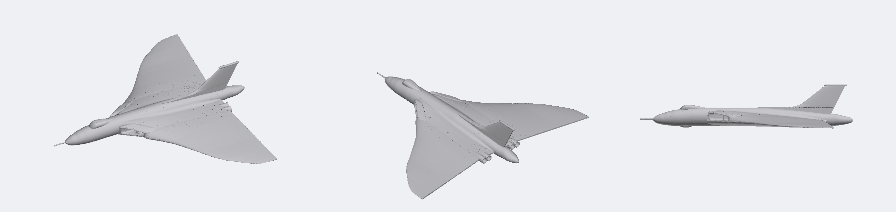

# Avro Vulcan B.2 snap kit

Avro Vulcan B.2 at 1:96: 352 mm span, 317 mm long (334 mm with the refuelling probe), about the span of a 1:32 Spitfire. To be a fully printed, multi-colour snap kit like the Halifax and the Hawk.

## Brief (agreed 2026-11-13)

- **Scale:** 1:96, chosen for a span close to the user's 1:32 Spitfire kit (351 mm if that kit is 1:32: its file is not in this repo, so the figure is from the real span, 11.23 m). The shape is built at 1:72 (`SCALE`) and scaled by `PRINT_K` 0.75 on output.
- **Two print files:** anti-flash white, and XH558's camouflage (grey and green over light grey; check every detail against photos).
- **Display:** stand with the wheels up, and gear down, both in the kit; a bomb bay that can be built open, with a Blue Steel missile as an alternative load.
- **For MakerWorld:** a single-colour version for printers without an AMS; plates that fit 256 mm beds; no supports, no glue.



> **Status: v1, outer shape only.** One solid in the assembled frame, built from one low-resolution 3-view. Not yet split into parts; no joints, colour or print file.

## Build

```bash
.venv/bin/python vulcan/cad/vulcan.py out/vulcan/NAME        # about 10 s
.venv/bin/python common/tools/ref_overlay.py out/vulcan/NAME/assembled plan OUT.png --refs vulcan/tools/refs.json   # also: side, front
.venv/bin/python common/tools/render.py out/vulcan/NAME/assembled OUT.png --views high34,lowfront,highrear --zoom 1.5
```

`vulcan/cad/vulcan.py` holds the shape as station tables. Lofts are ruled point rings built straight in manifold3d (`ring_loft`); CadQuery is not used.

## Shape and references

- Real dimensions: span 33.83 m, length 30.45 m without the probe, height 8.28 m, wing area 368.3 m².
- The only drawing so far is the aerospaceweb.org 3-view (466 × 334 px, about 1.5 mm per pixel at 1:72, the scale the shape is built at), calibrated in `tools/refs.json`. Its plan view is drawn about 4% wider in span than in length, so each axis has its own scale.
- Check: the model's wing area is 351.5 m² with the trailing edge cut back between the jet pipes, about 364 m² with a straight trailing edge, within about 1% of the real figure.
- The trailing edge is the outermost line of the plan view. The line inboard of it is the elevon hinge line (the first trace took it for the trailing edge and the area came out 13% low).

## Known gaps and next steps

1. Better references: the Wikimedia Commons vector 3-view ("Avro Vulcan B.2 3-view line drawing.svg") and the Airfix A12011 instruction sheets. Commons rate-limited the cloud session and Scalemates refuses automated downloads; fetch them by hand into `ref/vulcan/` and recalibrate.
2. Shape still to do: engine bulges under the wing, the fin root fillet, the drooped outer leading edge, the nose gear and main gear bays, the bomb bay, the ECM plate between the starboard jet pipes, the terrain-following radar thimble on the nose.
3. The wing's vertical position and droop come from a coarse head-on view: check them against photos.
4. Agree the brief (markings, display, colours per plate), then split into parts, add joints, colour and the 3MF.
