# Avro Vulcan B.2 snap kit

Avro Vulcan B.2 at 1:96: 352 mm span, 317 mm long (336 mm with the refuelling probe), about the span of a 1:32 Spitfire. To be a fully printed, multi-colour snap kit like the Halifax and the Hawk.

## Brief (agreed 2026-11-13)

- **Scale:** 1:96, chosen for a span close to the user's 1:32 Spitfire kit (351 mm if that kit is 1:32: its file is not in this repo, so the figure is from the real span, 11.23 m). The shape is built at 1:72 (`SCALE`) and scaled by `PRINT_K` 0.75 on output.
- **Print files:** anti-flash white (Airfix scheme B: XM602, No. 12 Squadron, 1963), and camouflage on top with a plain underside (Airfix scheme A: XM594, Scampton, 1966: grey and green over white). Camouflage wrapped round the underside (as XH558 flew) is an option: alternative lower shells.
- **Display:** stand with the wheels up, and gear down, both in the kit; a bomb bay that can be built open, and a Blue Steel missile option (user, confirmed).
- **For MakerWorld:** a single-colour version for printers without an AMS; plates that fit 256 mm beds; no supports, no glue.


> **Status: v20: shape fitted to the Airfix A12011 plan and side views, and split into shells.** No joints, colour or print file yet. Not yet split into parts; no joints, colour or print file.

Intakes (v18, user: "the spline shape is an important detail to get right"). The mouth is one outline measured on the colour head-on photo (12.2 px per model mm): tall at its inner end (z -5.3 to 8.2 at y 23.8, a nearly upright inner edge with rounded corners), tapering through gently bowed top and bottom lips to a round outer end at y 56 (`INTAKE_INNER`, `INTAKE_OUTER`, `INTAKE_BOW`; `mouth_outline` builds it as a convex hull with rounded corners, 144 points). A half-round lip 3 mm thick (2.25 printed) runs all the way round it (`INTAKE_LIP`), and in plan it follows the wing's leading edge, so the notch at y 50-58 is its outer end. The inner wall's leading edge bows 5.5 mm forward at mid-height, as in the side-on photo (`INTAKE_WALL_BOW`), and stands 2 mm off the fuselage with an open slot behind it. One opening, with the wall between the two engine ducts set back 9 mm. Over the engines the wing's top is not an aerofoil hump: it reaches its crest just behind the lip and runs almost straight to the trailing edge (`WING_ROOT_UP`, `WING_CREST`). Still not right: the real wing round the mouth is thicker, so its lips have heavier shoulders above and below than the model's, and the outer end runs more smoothly into the outer wing's leading edge. Top: the photo; middle: the model; bottom: the side-on photo.

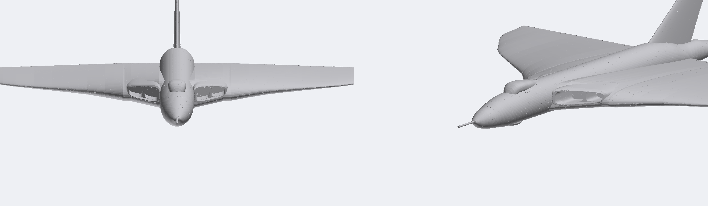

Rear fuselage (v9, user review against the XH558 Farnborough photo and the Airfix top view): the body tapers and its top falls away from x 225 (1:72), under a long dorsal ridge that is part of the fin and keeps the top line level (`FIN_RIDGE`); the fin so starts 80 mm further forward than its main leading edge. The jet pipes sit across the trailing edge (`JET_Z`), so their tops show as humps on the upper surface over the last 40 mm.

Smooth upper surface (v10, user: "seamlessly incorporating the engines"): every concave crease on top over the engines, and underneath round the jet pipe fairings, is filled as if a ball had been rolled over it (`surface_blend`: a height field of the surface, closed with a 12 mm ball along the fuselage, 4 mm by the intakes and underneath, fading out at the trailing edge). The intake fairing now ends 45 mm behind the lip, under the wing's own crest, and the inboard thickness follows a smooth curve into the outer wing. Sections before (black) and after (red):

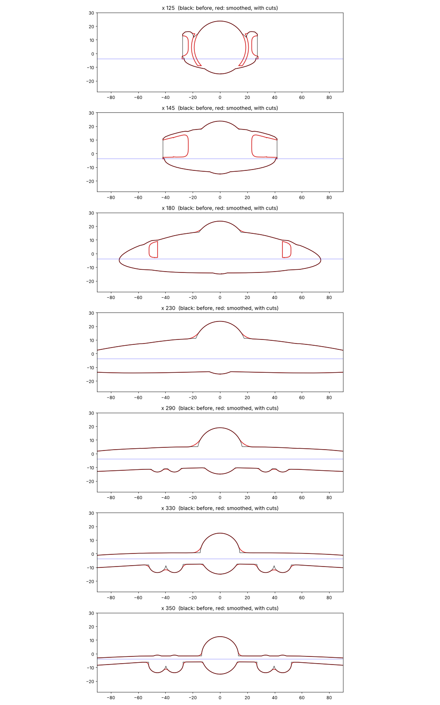

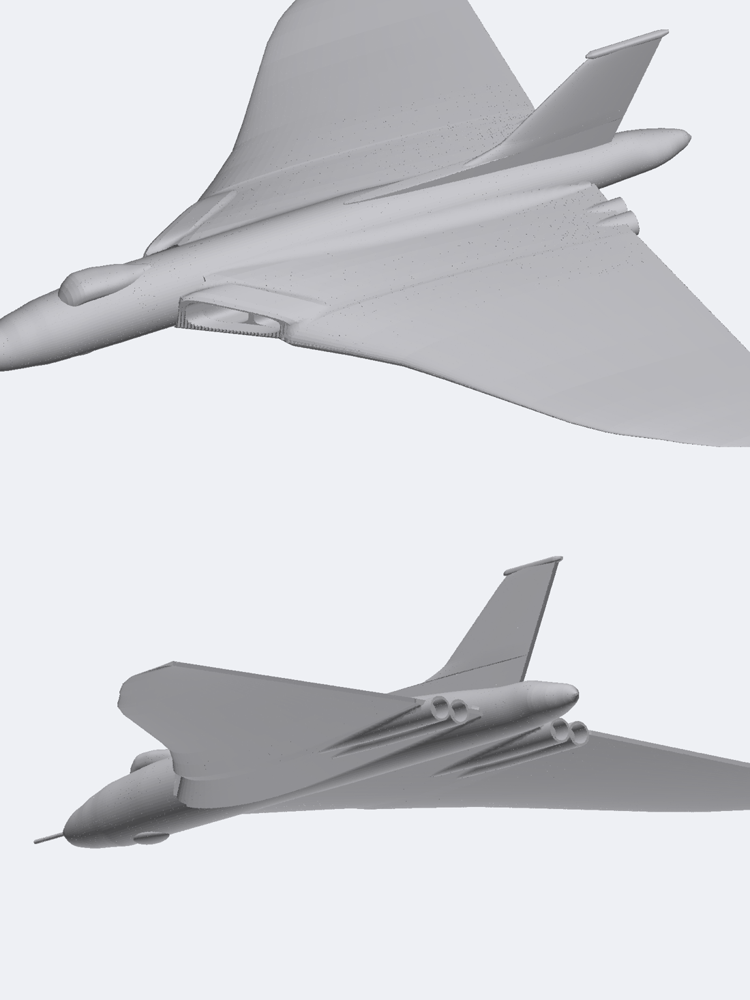

Panel lines (v11): the upper surface carries the main lines from the Airfix scheme B top view, read on a 10 mm grid (`PANEL_LINES`, `HINGE_LINES` in `vulcan.py`): the engine bay panels, the leading-edge and rear spar lines, the outer wing joint, every other skin stiffener, the jet pipe panels, and the elevon hinge and ends (deeper). 0.5 mm wide and 0.25 mm deep as printed (hinges 0.6 x 0.4). Underneath (v12, from the scheme B underside view; `UNDER_LINES`, `UNDER_DOORS`, `UNDER_STBD`): the engine doors, crew hatch, the outer wing's lines as on top, the plate under the starboard jet pipes, and, cut deeper, the bomb bay doors (123 x 43 mm at 1:72, x 187 to 310), the nose gear doors and the main gear doors. Still to do: the fuselage and fin, airbrakes.

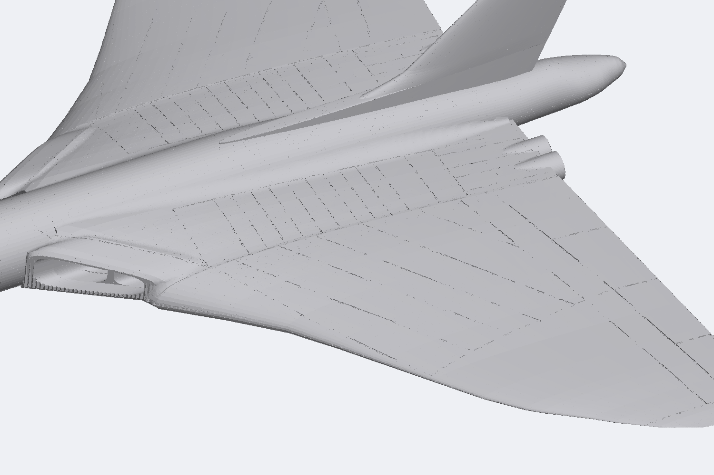

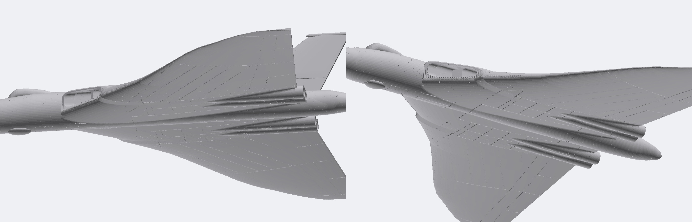

Bays and belly (v13): the bomb bay (92 x 32 mm printed), nose gear bay and both main gear bays are cut into the lower shells, each with a ledge; a door panel cut from the shell's own skin drops in from below (`door_bomb`, `door_nose`, `door_main_stbd/port`), or is left out for an open bay. A ribbed roof plate (`bomb_bay_roof`) is trapped between the centre shells. Fitting the bomb doors showed the belly was wrong: under the wing the body is a flat-bottomed keel, not a tube (`KEEL_STATIONS`). The inboard underside now comes up to the intake's lower lip on a long ramp (`WING_UNDER_RAMP`). Top: bays open; bottom: door panels fitted.

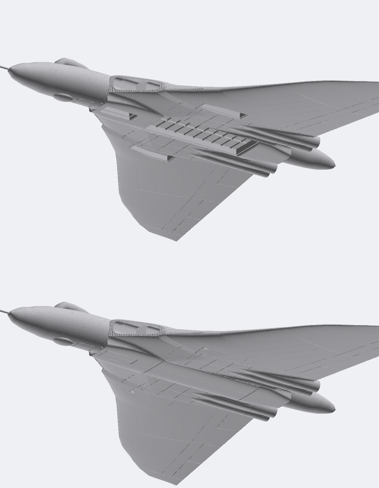

Landing gear (v14): nose leg with twin wheels, and two main legs with eight-wheel bogies, drag braces and shock struts, from the Airfix side view on a 5 mm grid, the instruction pages and photos. Each leg is two flat halves split on its centre plane (`*_gear_*_a/b`), printed lying on that plane with the wheels moulded on top (no loose axles; flares and tyre grooves at 45 degrees, so no overhang). The halves' top ends form one plug, pushed up through the bay roof into a socket that runs on into the upper shell. For gear down, each bay takes a frame that sits on the ledge with the open doors standing from it (`doors_open_nose`, `doors_open_main_*`) in place of the closed door panel. Ground line z -46.5 (1:72): the belly is 23.6 mm off the table as printed. Legs are thicker than scale (3.3 mm printed).

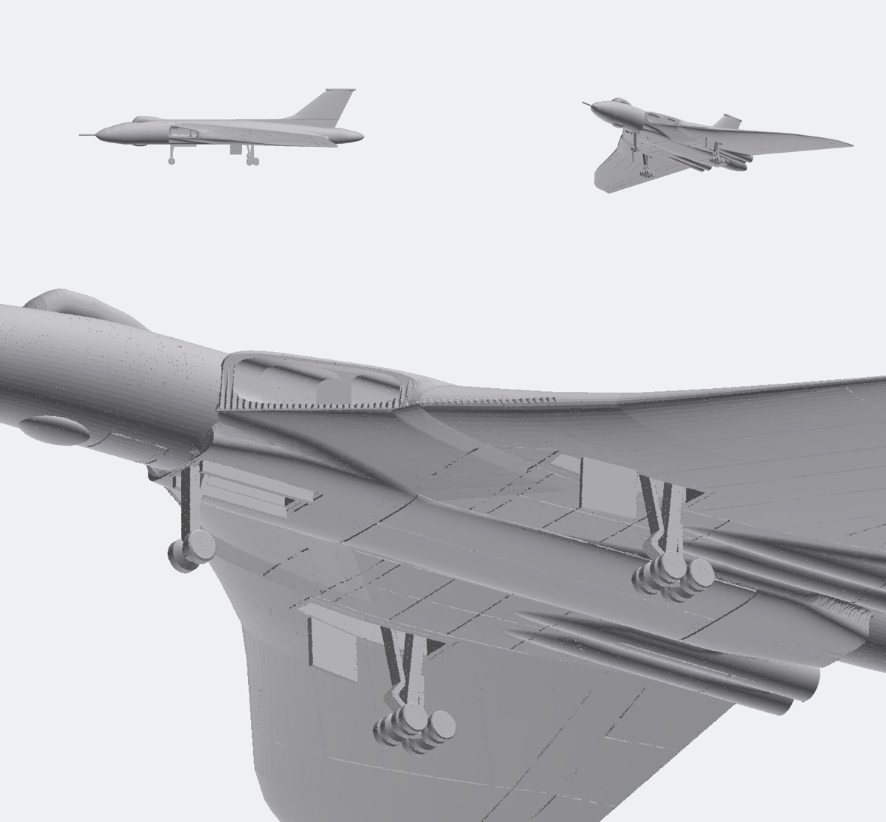

Blue Steel (v15): the stand-off missile from the Airfix scheme A sheet (149 mm long at 1:72, 112 mm printed), carried half sunk in the bomb bay with its nose 21 mm ahead of the bay. The kit part (`blue_steel`) is the half below the belly, printed on its flat top face with the wings and foreplanes on the bed; two keys on its own bomb door panel (`door_bluesteel`, fitted in place of `door_bomb`) hold it. The centreline is put on the belly line so the part prints flat: the real missile sat slightly lower. The top fin (inside the bay) and the folded lower fin are left off.

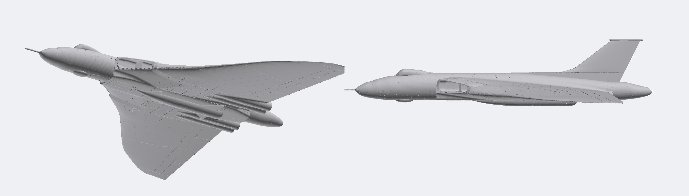

Stand (v16): a blade post (`stand_post`, printed flat) with a 6 mm square key that goes up through its own bomb door panel (`door_bomb_stand`) into the bay roof plate, and a tenon into a 150 x 100 x 8 mm plinth (`stand_base`). The aircraft sits 8 degrees nose-up, belly 80 mm above the plinth. The plain `door_bomb` has no hole. Not yet possible: the stand together with the Blue Steel.

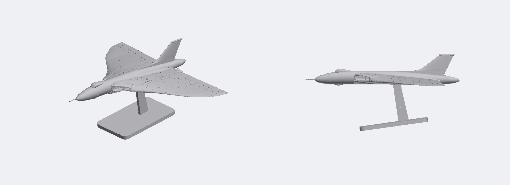

Interference check (`common/tools/interference.py`, gear down with the Blue Steel, keys left out): clean.

Joints (v17, untested: print coupons before trusting any fit). Every key is a 3 mm plate standing on edge across the split surface, upright in the assembled frame, so the keys go into the lower shells and every upper shell drops straight down onto them (`KEYS`, `add_joints`). 26 keys in 7 sizes: 20 short ones (6 mm long, 3.2 to 10 mm tall, the height found from the material at each place) between upper and lower shells, 2 of 18 mm across the front/centre joint and 4 spars of 30 mm across the wing joints. The radome pushes onto a tongue moulded half on each front shell; the probe (2 mm, thicker than scale) plugs into the radome tip; the fin is two halves printed on their split faces, its root in a slot of its own shape. Checks: no overlaps between parts, every part one piece. Not keyed yet: the wing shells outboard of y 150 (too thin for a key: the tips may need a lip), and the two fin halves to each other above the slot.

Engine faces (v20, user: "like you can see the engines if you look in the intakes"; silver pieces fitted at assembly). Each duct ends in a round tunnel (8.25 mm bore printed) with a compressor face at its end: a hub cone and 10 swirled blades in relief on a small plate (`engine_face_*`, 4 of them, 11 x 10 x 3 mm), printed face up and dropped into a slot between the centre shells. All four faces are at the same station, x 192 at 1:72 (user review: further back, and the same distance from the nose), so the inner ducts are 70 mm long at the fuselage side; the wall between the two ducts starts 24 mm behind the lip (`ENGINES`, `ENGINE_FAN`, `INTAKE_SPLIT`). The long duct roofs print as bridges up to 24 mm wide in the upper shell: hidden, but check them on the first print. Left: from slightly above; right: straight in.

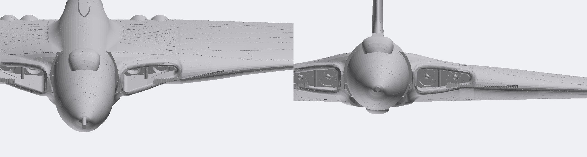

## Parts (v6: first split, no joints yet)

Upper and lower shells, as in a plastic kit, so every underside part prints in one colour and both skins print as top layers. The split surface holds the wing's leading and trailing edges: level at z -4 (1:72) across the centre body, then a plane falling 3.2 degrees to the tip on each outer wing. Upper shells print standing on the split face; lower shells are turned over onto it.

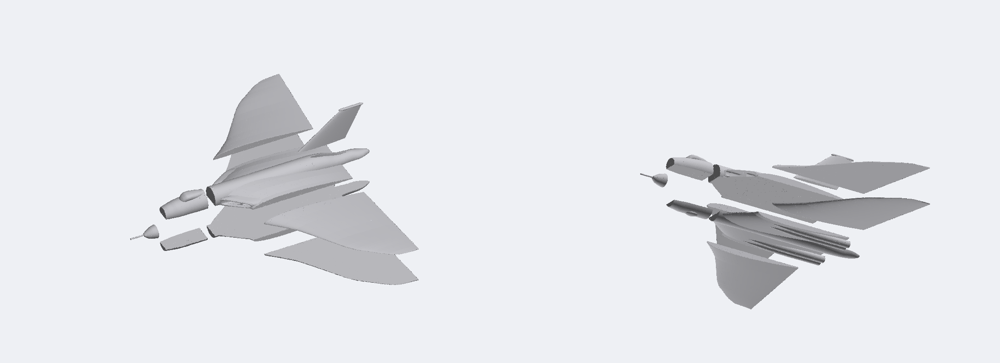

61 parts in all, 26 of them keys (`out/.../print/`, each in its print pose at printed size):

| Part | Printed size (mm) |
|---|---|
| `radome` (on end) | 18 x 19 x 18 |
| `front_upper`, `front_lower` | 61 x 28 x 25, 61 x 26 x 11 |
| `centre_upper`, `centre_lower` | 238 x 86 x 22, 238 x 86 x 8 |
| `wing_stbd_upper/lower`, `wing_port_upper/lower` | 165 x 134 x 9, 165 x 134 x 8 |
| `bomb_bay_roof` | 95 x 35 x 2.6 |
| `door_bomb`, `door_bomb_stand`, `door_bluesteel` (one of) | 92 x 32 x 2 to 3.8 |
| `blue_steel` | 112 x 39 x 6.6 |
| `door_nose`, `door_main_stbd/port` (wheels up) or `doors_open_nose`, `doors_open_main_stbd/port` (gear down) | up to 40 x 11 x 12 |
| `nose_gear_a/b`, `main_gear_stbd_a/b`, `main_gear_port_a/b` | 10 x 36 x 4, 16 x 36 x 6 |
| `stand_post`, `stand_base` | 34 x 95 x 6, 150 x 100 x 8 |
| `fin_stbd`, `fin_port`, `probe`, 26 `key_*` | 141 x 51 x 3; 25 x 2 x 2 |

All fit a 230 x 250 mm plate. Overhangs: none on the wings, doors, gear, stand, roof or front shells; `centre_upper` (intake duct roofs) and `centre_lower` (jet pipe bores, bay ledges) still have some.

Still to do on the split: test coupons for every joint, separate jet nozzles, the stand with the Blue Steel fitted, something to hold the wing tips' shells together.

## Build

```bash
.venv/bin/python vulcan/cad/vulcan.py out/vulcan/NAME        # about 10 s
.venv/bin/python common/tools/ref_overlay.py out/vulcan/NAME/assembled plan OUT.png --refs vulcan/tools/refs.json   # also: side, front
.venv/bin/python common/tools/render.py out/vulcan/NAME/assembled OUT.png --views high34,lowfront,highrear --zoom 1.5
```

`vulcan/cad/vulcan.py` holds the shape as station tables. Lofts are ruled point rings built straight in manifold3d (`ring_loft`); CadQuery is not used.

## Shape and references

- **Main drawings:** the Airfix A12011 painting guide, scheme A (XM594, Scampton 1966): flat upper plan, underside plan and both side views, with panel lines, at about 0.97 mm per pixel at 1:72 (a screenshot; a sharper copy would help). Calibrated in `tools/refs.json` as `plan` and `side`. The outline sits on both.
- **Sharper views (2026-11-14, user uploads, in `ref/vulcan/`):** each Airfix view as its own zoomed screenshot, about 0.44 mm per pixel at 1:72: `airfix_a_top`, `airfix_a_side_port`, `airfix_a_under_bluesteel` (with the Blue Steel's side and plan views), `airfix_b_top`, `airfix_b_side_stbd`, `airfix_b_under`. `plan` and `side` in `tools/refs.json` now point at the scheme A ones; the first screenshots are `plan_lo` and `side_lo`. Also Airfix instruction pages 22-23 (main gear: leg, bogie with 8 wheels, doors, bay), a side-on photo of the canopy and nose roundel, a photo of a main gear bogie, the nose gear side-on at take-off, a colour head-on photo on the ground (intakes, splitter plates, all three gear legs) and two photos of the open bomb bay.
- **Other sources:** the Commons silhouette (`sil_plan`, `sil_front`; sharper, 0.51 mm per pixel, and its wing agrees within about 3 mm, but its tail cone is 17 mm short) and the aerospaceweb.org 3-view (`aw_plan`).
- **Length:** 422.5 mm at 1:72 from nose tip to tail cone: the published 99 ft 11 in (30.45 m), without the probe. With the probe 448.5 mm (32.3 m; published 105 ft 6 in).
- **Check:** the model's wing area is 367.4 m², against the real 368.3 m².
- **Photos (in `ref/vulcan/`, not in git):** XH558 from below with the bomb bay open (camouflage wraps round the underside), a head-on photo from 1982 (intakes, nose, probe), a top view of a camouflaged Vulcan on a runway (2024, airframe not identified), a straight-down top view (watermarked stock photo: measure only, mind the watermarks when tracing), a top-view camouflage illustration, a wrapped-camouflage underside in flight, XH558's nose and intakes (roundel, badge, lettering, nose gear), XH558's fin (fin flash without white, Union flag, shield, serial, fin cap, jet pipes), and model photos from aircraftinplastic.com.
- The trailing edge is the outermost line of a plan view. The line inboard of it is the elevon hinge line.

## Known gaps and next steps

1. Still wanted: sharper copies of the Airfix A12011 painting guides (scheme A, and scheme B: XM602 in anti-flash white, 1963; both are in `ref/vulcan/` as screenshots), and for XH558 a straight-down view of its upper camouflage.
2. Shape still to do: the drooped outer leading edge, the nose gear and main gear bays, the bomb bay, the ECM plate between the starboard jet pipes, the terrain-following radar thimble on the nose.
3. The wing's height on the fuselage, its root thickness and the intake lips come from a silhouette and one head-on photo: check them against more photos. The intakes are plain slots so far (the real lips are rounded, with a splitter plate at the fuselage).
4. Agree the brief (markings, display, colours per plate), then split into parts, add joints, colour and the 3MF.
